# Almond generated asset library

Open, redistributable 3D architectural assets for [Almond MCP](../README.md):
entourage, site furniture, fixtures and unbranded
furniture placeholders. **144 assets**, generated with
[Meshy](https://www.meshy.ai) (eleven with Tripo; thirty Project Y2K kit pieces built by Blender scripts; see the batches) from prompts written for this project and
normalised to real-world millimetres with an authored Almond spatial
contract. Unlike the IKEA / drawing libraries (3D Warehouse content that
each user downloads), these files ship with the repository.

- **License:** models are released under
  [CC BY 4.0](https://creativecommons.org/licenses/by/4.0/) - attribute as
  "Almond generated asset library (github.com/liangjunglj-cpu/almond-mcp)".
  Contracts, manifest, catalogue and tooling are MIT with the rest of the repo.
- **Units / axes:** millimetres; glTF Y-up in the file (Rhino's importer maps
  it to Z-up); bottom-centre at the origin; width = X, depth = Y (Rhino).
- **Materials:** one `ALMOND::<material_id>` material per asset so
  `import_asset_contract` / `place_generated_asset` restore the canonical
  Almond PBR values and `almond:*` metadata on import.
- **Dimensions are measured**, not nominal: the manifest records the real
  bounds of the normalised GLB (height is scaled exactly to the catalogue
  height; plan dimensions are whatever the generator produced, with the
  nominal target kept in `nominal_dimensions_mm` and the deviation in
  `plan_dimension_deviation`).

## Files

| Path | What |
| --- | --- |
| `catalogue.json` | Source of truth: asset ids, prompts, nominal sizes, material, clearances, generation recipe |
| `provenance.json` | Meshy task ids (concept image + mesh) and dates per asset |
| `manifest.json` | Generated by the build script; what the server indexes (schema 2.0, like the other libraries) |
| `models/<id>.glb` | Normalised mesh |
| `models/<id>.almond.json` | Asset contract (dimensions, anchor, clearances, material groups) |
| `raw/` | Raw Meshy downloads (gitignored) |
| `previews/` | 640 px material-colour archive thumbnails, render provenance and legacy contact sheets (Blender Workbench) |

## Using the library

```text
list_generated_assets(category="site_furniture")
search_generated_assets(query="tree", max_height_mm=8000)
get_generated_asset(asset_id="gen-street-lamp-1")
place_generated_asset(asset_id="gen-street-lamp-1", x_mm=0, y_mm=0)
```

The wheel ships the manifest, catalogue and previews; each model GLB and its contract download from the
GitHub release of the matching version on first use (`almond-mcp fetch-assets --generated` prefetches all 144).
Run `almond-mcp audit-assets` to check checksums and agreement between embedded,
sidecar and manifest passports. Wheel installs use a versioned user-data pack;
explicit library directory overrides continue to take precedence.

## Embedded passports and reasoning tools

Each GLB contains `asset.extras.almond.passport`; nodes carry stable Almond
identity references. The same passport lives in the `.almond.json` contract
and the manifest, validated against `passport.schema.json`. It records
measured and nominal dimensions separately, source prompts and Meshy task ids,
materials, clearances, support plane, usage suggestions, quality caveats and
attribution. Suggested rooms are category/label heuristics, not audited facts.

```text
recommend_generated_assets(query="bench", width_mm=2400, depth_mm=1600)
get_generated_asset_passport(asset_id="gen-park-bench-1")
evaluate_generated_asset_fit(asset_id="gen-park-bench-1", width_mm=2400, depth_mm=1600)
```

Read `almond://generated/catalogue` and the per-asset `/passport` and `/preview`
resources from an MCP client. Clearances are authored design allowances;
rectangular fit does not check actual room obstacles or certify accessibility.
Existing geometry remains unchanged. These legacy GLBs contain numeric mm,
so a generic metre-based glTF viewer needs a 0.001 scale conversion; Almond's
existing Rhino placement uses its millimetre contract.

Run `python tools/enrich_generated_assets.py` to refresh passports on existing
normalised models. The normalisation builder also embeds passports for new
models. `almond-mcp audit-assets` verifies the result.

## Assets

Contact sheets: [entourage](previews/sheet-1-entourage.png) · [site furniture](previews/sheet-2-site-furniture.png) · [components](previews/sheet-3-components.png) · [fixtures](previews/sheet-4-fixtures.png) · [furniture](previews/sheet-5-furniture.png) · [lighting](previews/sheet-6-lighting.png). Regenerate with `blender -b --python tools/render_generated_previews.py -- GeneratedAssetfiles/models <out>`.

| Preview | asset_id | Product | Category | W x D x H (mm) | Material | Triangles |
| --- | --- | --- | --- | --- | --- | --- |
| 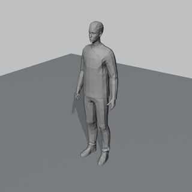 | `gen-person-standing-1` | Person standing (adult, casual clothing) | human_figure | 578 x 284 x 1750 | `plaster-white` | 4,383 |
| 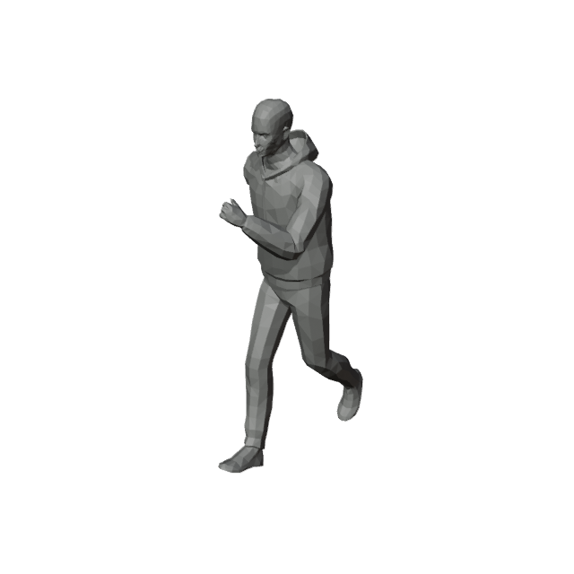 | `gen-person-walking-1` | Person walking (adult, mid-stride) | human_figure | 584 x 1032 x 1750 | `plaster-white` | 4,270 |
| 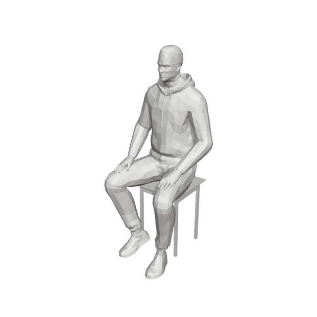 | `gen-person-sitting-1` | Person sitting (adult, seated on a plain stool) | human_figure | 562 x 588 x 1300 | `plaster-white` | 4,153 |
| 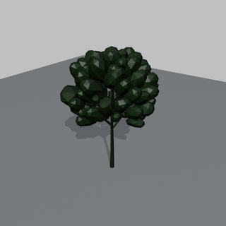 | `gen-tree-deciduous-medium-1` | Deciduous tree (medium, round crown) | vegetation | 5207 x 4884 x 7000 | `foliage-pine` | 80,000 |
| 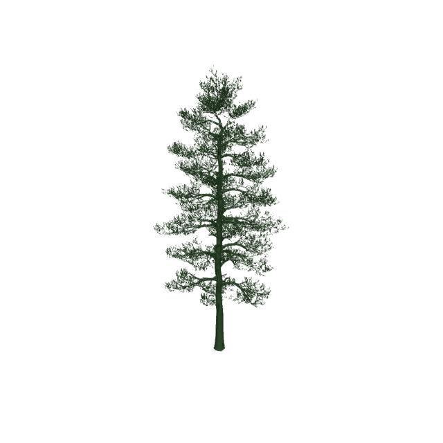 | `gen-tree-conifer-1` | Conifer tree (tall, narrow) | vegetation | 3837 x 3717 x 9000 | `foliage-pine` | 80,000 |
| 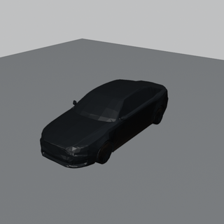 | `gen-car-sedan-1` | Car (generic mid-size sedan) | vehicle | 2057 x 5050 x 1450 | `steel-painted-charcoal` | 4,198 |
| 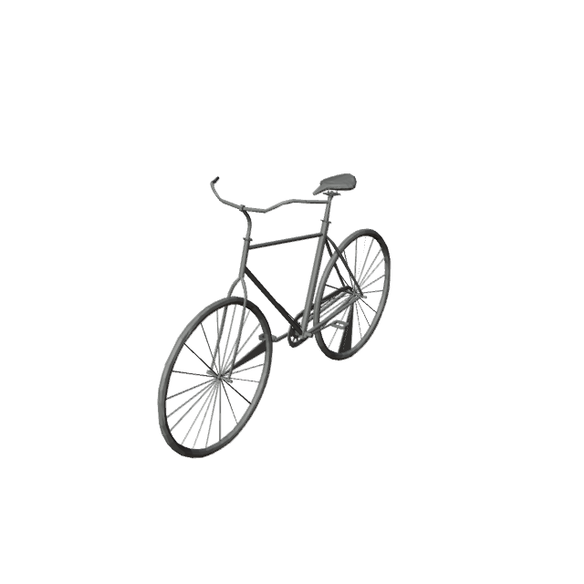 | `gen-bicycle-1` | Bicycle (city bike) | vehicle | 560 x 1654 x 1050 | `steel-painted-charcoal` | 4,322 |
| 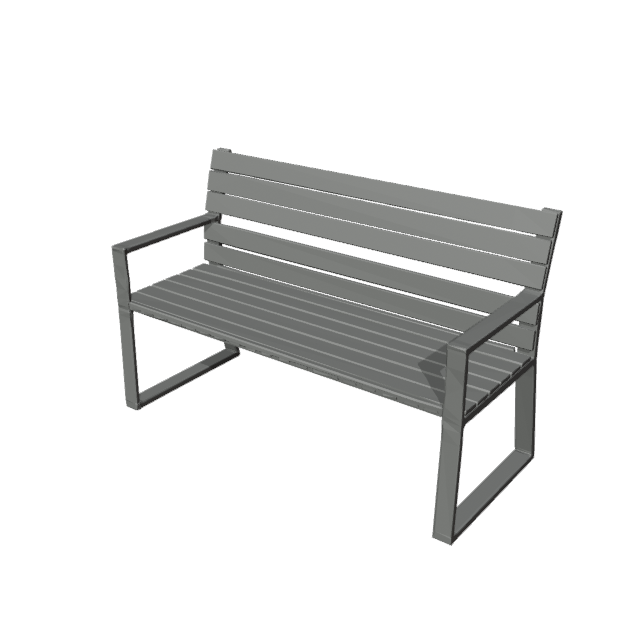 | `gen-park-bench-1` | Park bench (timber slats, steel frame) | site_furniture | 1331 x 565 x 850 | `wood-oak` | 3,990 |
| 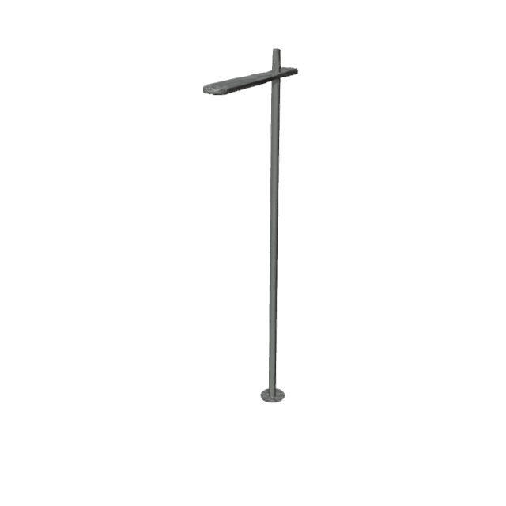 | `gen-street-lamp-1` | Street lamp (single-arm LED) | site_furniture | 320 x 1441 x 4500 | `steel-painted-charcoal` | 3,979 |
| 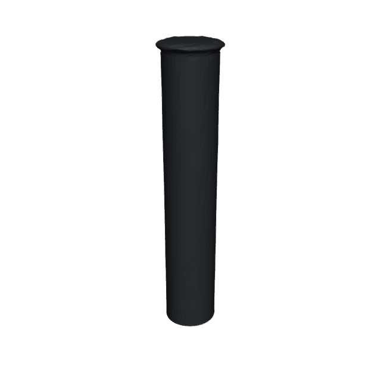 | `gen-bollard-1` | Bollard (cylindrical steel) | site_furniture | 191 x 189 x 900 | `steel-painted-charcoal` | 4,278 |
| 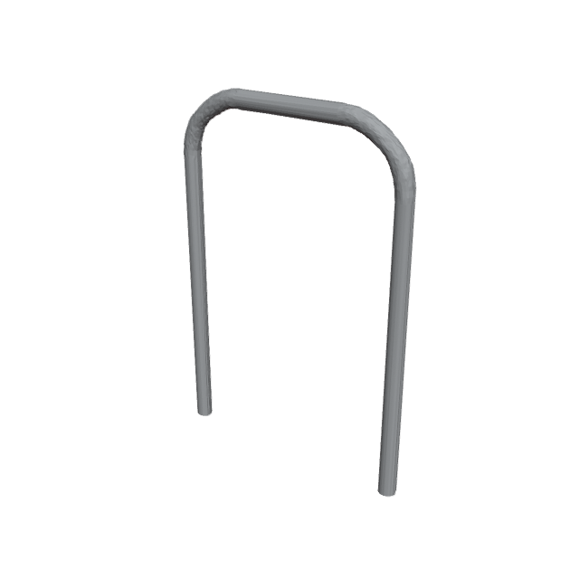 | `gen-bike-rack-1` | Bike rack (inverted U hoop) | site_furniture | 553 x 36 x 800 | `steel-galvanized` | 4,179 |
| 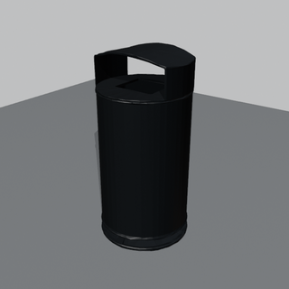 | `gen-litter-bin-1` | Litter bin (cylindrical public) | site_furniture | 491 x 490 x 1000 | `steel-painted-charcoal` | 4,402 |
| 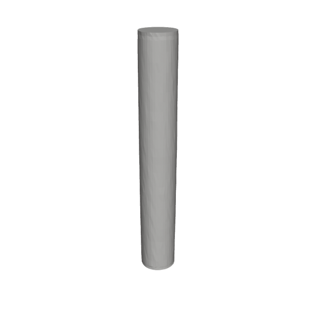 | `gen-column-round-1` | Round column (plain concrete) | column | 454 x 457 x 3000 | `concrete-smooth` | 4,436 |
| 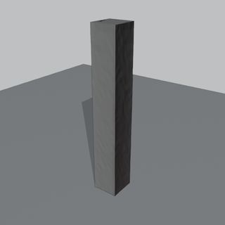 | `gen-column-square-1` | Square column (plain concrete) | column | 472 x 497 x 3000 | `concrete-smooth` | 4,258 |
| 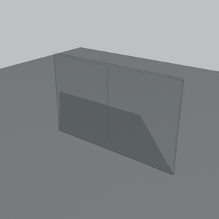 | `gen-balustrade-glass-1` | Glass balustrade (frameless with steel handrail, 2 m segment) | railing | 1744 x 21 x 1100 | `glass-clear` | 4,026 |
| 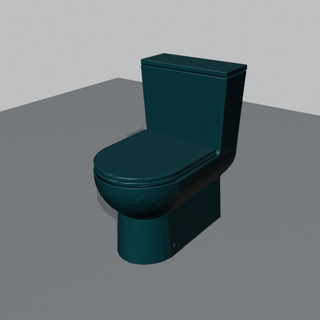 | `gen-toilet-1` | Toilet (close-coupled floor mounted) | sanitary | 448 x 670 x 800 | `ceramic-teal` | 4,216 |
| 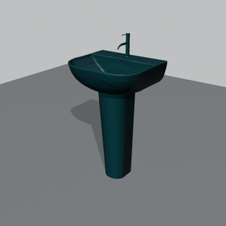 | `gen-washbasin-pedestal-1` | Washbasin (pedestal with mixer tap) | sanitary | 445 x 382 x 850 | `ceramic-teal` | 3,986 |
| 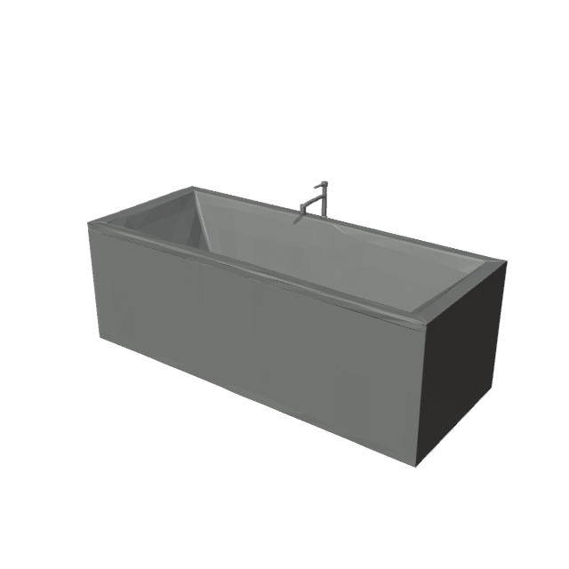 | `gen-bathtub-1` | Bathtub (rectangular built-in) | sanitary | 1274 x 524 x 580 | `ceramic-teal` | 4,277 |
| 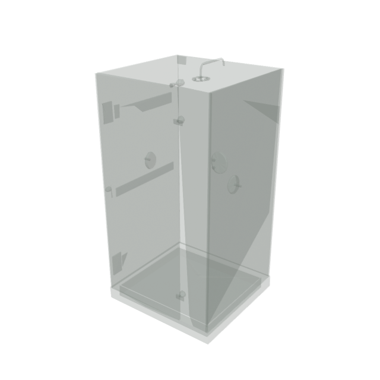 | `gen-shower-enclosure-1` | Shower enclosure (square, glass, low tray) | sanitary | 1035 x 1035 x 2000 | `glass-clear` | 3,870 |
| 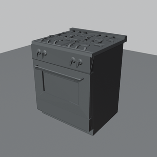 | `gen-kitchen-range-1` | Kitchen range (freestanding cooker with oven) | appliance | 715 x 728 x 900 | `steel-galvanized` | 2,935 |
| 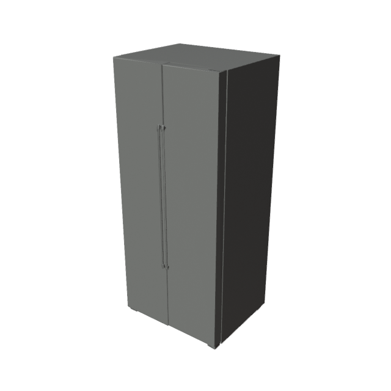 | `gen-refrigerator-1` | Refrigerator (freestanding fridge-freezer) | appliance | 766 x 671 x 1800 | `steel-galvanized` | 1,016 |
| 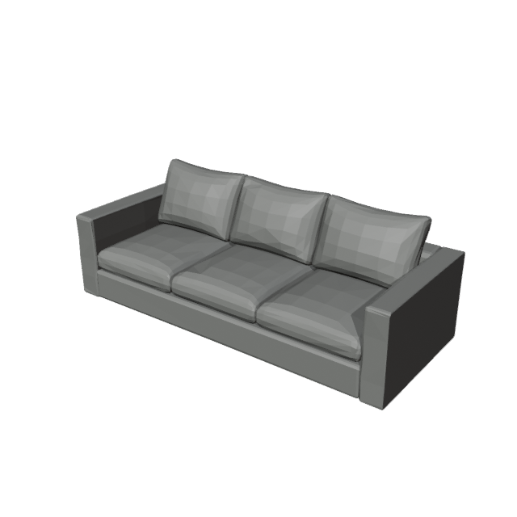 | `gen-sofa-3-seat-1` | Sofa (generic three-seat, fabric) | seating | 2346 x 983 x 850 | `rubber-black` | 4,087 |
| 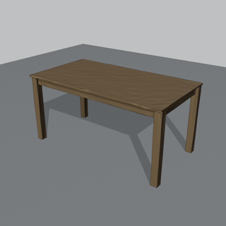 | `gen-dining-table-rect-1` | Dining table (generic rectangular, timber) | table | 1536 x 822 x 750 | `wood-oak` | 4,362 |
| 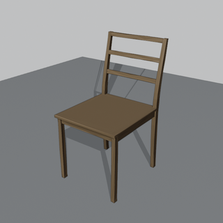 | `gen-dining-chair-1` | Dining chair (generic timber, armless) | seating | 462 x 566 x 900 | `wood-oak` | 4,337 |
| 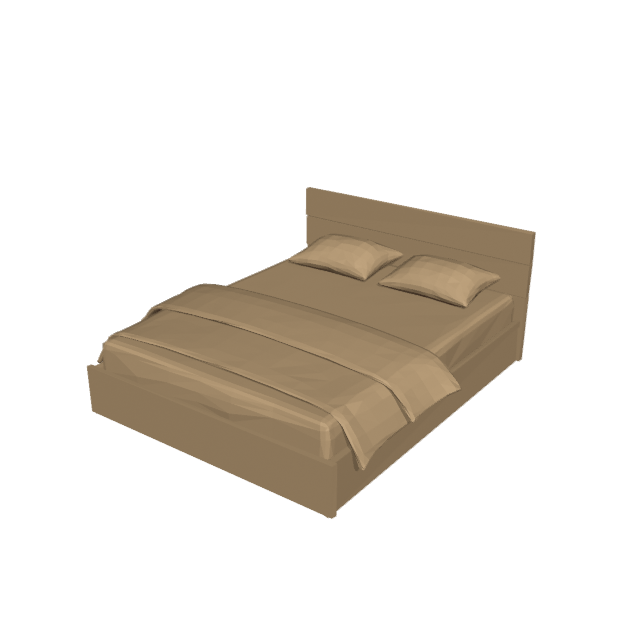 | `gen-bed-double-1` | Double bed (generic platform bed with mattress and headboard) | bed | 2213 x 2289 x 950 | `wood-oak` | 4,353 |
| 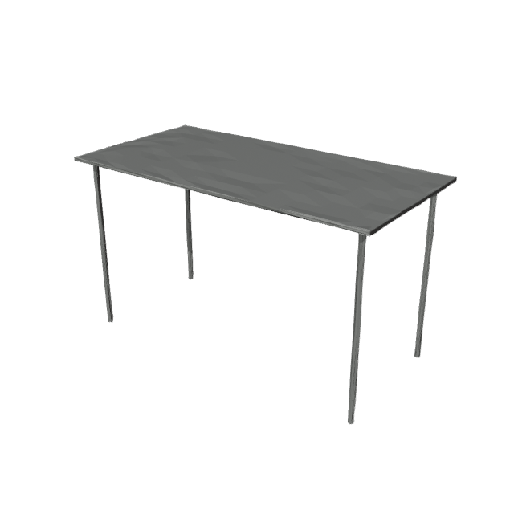 | `gen-desk-1` | Desk (generic writing desk, timber top, steel legs) | desk | 1306 x 656 x 750 | `wood-birch-ply` | 3,965 |
| 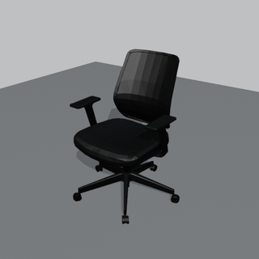 | `gen-office-chair-1` | Office chair (generic swivel task chair) | seating | 879 x 831 x 1100 | `rubber-black` | 4,101 |
| 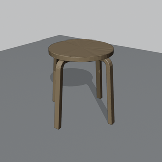 | `gen-stool-bent-birch-3leg-1` | Stool (three-legged bent-birch stool, round seat) | seating | 489 x 489 x 440 | `wood-birch-ply` | 4,125 |
| 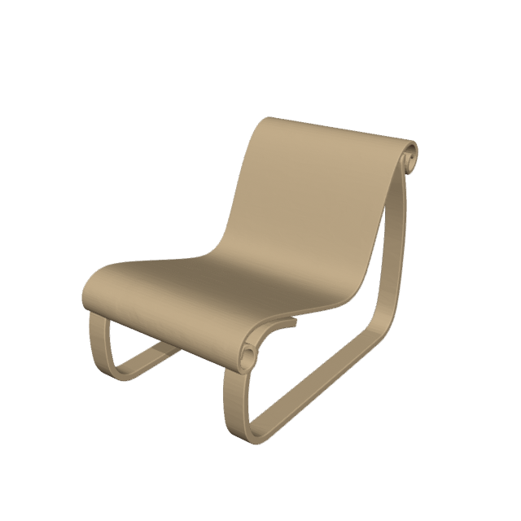 | `gen-lounge-chair-bent-plywood-1` | Lounge chair (cantilevered bent-plywood lounge chair, scroll seat) | seating | 565 x 911 x 640 | `wood-birch-ply` | 79,999 |
| 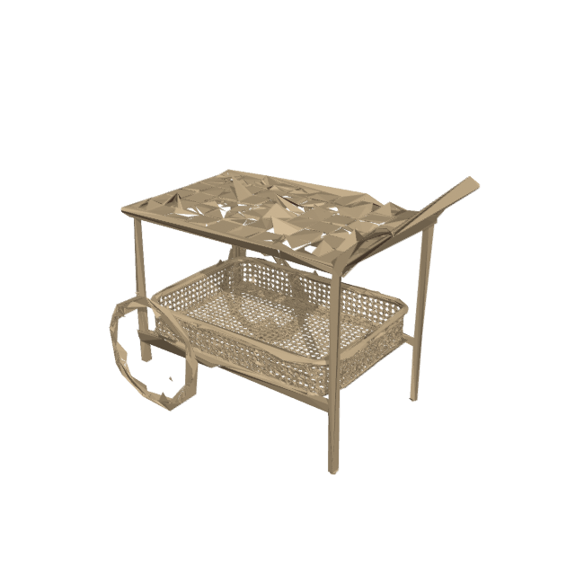 | `gen-tea-trolley-bent-birch-1` | Tea trolley (bent-birch frame, two large plywood wheels, rattan basket) | table | 771 x 490 x 600 | `wood-birch-ply` | 110,854 |
| 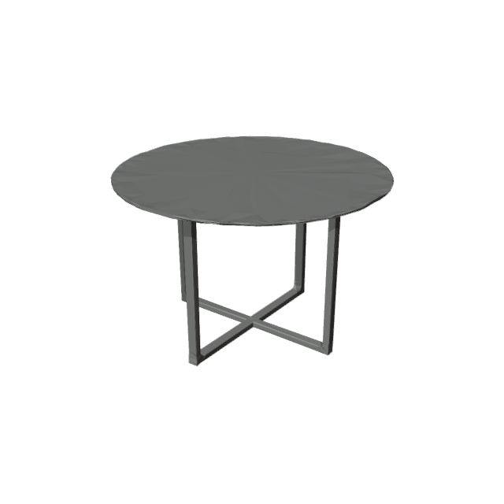 | `gen-dining-table-round-birch-1` | Dining table (round white laminate top on four bent-birch L-legs) | table | 1117 x 1117 x 720 | `wood-birch-ply` | 4,288 |
| 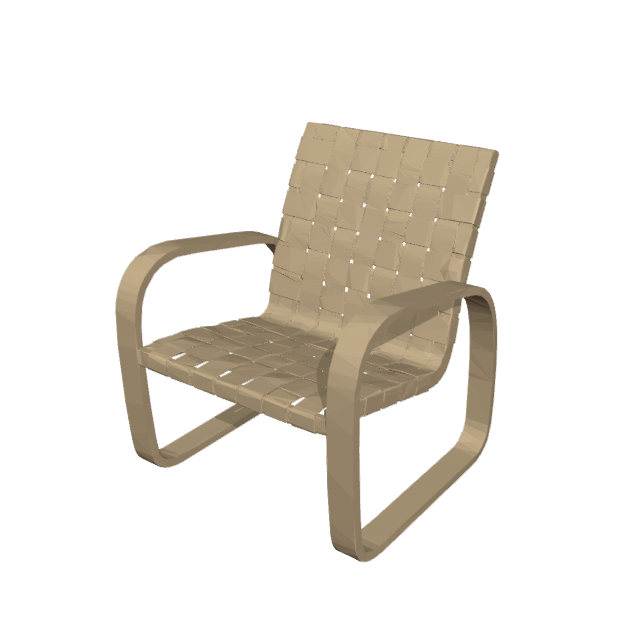 | `gen-armchair-bent-birch-webbed-1` | Armchair (bent-birch frame with linen webbing seat and back) | seating | 688 x 704 x 800 | `wood-birch-ply` | 79,977 |
| 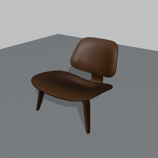 | `gen-lounge-chair-molded-plywood-1` | Lounge chair (moulded plywood lounge chair, low, wood legs) | seating | 732 x 831 x 680 | `wood-walnut` | 79,996 |
| 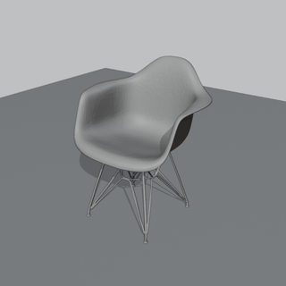 | `gen-side-chair-shell-wire-base-1` | Side chair (moulded shell seat on wire tower base) | seating | 659 x 595 x 800 | `plaster-white` | 80,000 |
| 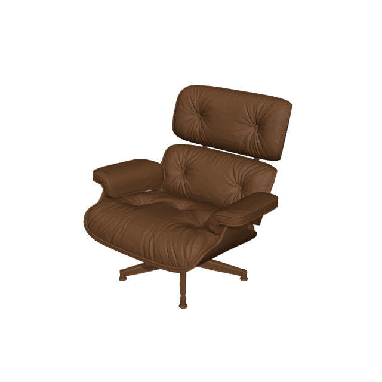 | `gen-lounge-chair-leather-plywood-1` | Lounge chair (leather lounge chair, three bent plywood shells, swivel base) | seating | 882 x 899 x 840 | `wood-walnut` | 79,998 |
| 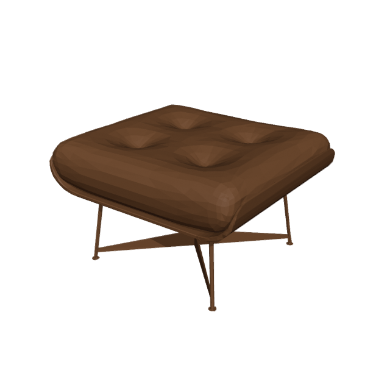 | `gen-ottoman-leather-plywood-1` | Ottoman (matching leather ottoman on aluminium base) | seating | 703 x 653 x 430 | `wood-walnut` | 3,976 |
| 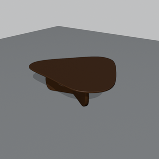 | `gen-coffee-table-freeform-glass-1` | Coffee table (freeform glass top on two-piece sculptural wood base) | table | 1439 x 1274 x 400 | `wood-walnut` | 57,260 |
| 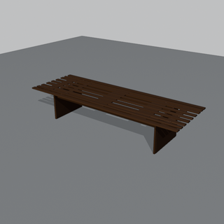 | `gen-bench-slatted-platform-1` | Bench (slatted wood platform bench on ebonised frame) | seating | 1800 x 624 x 355 | `wood-walnut` | 3,581 |
| 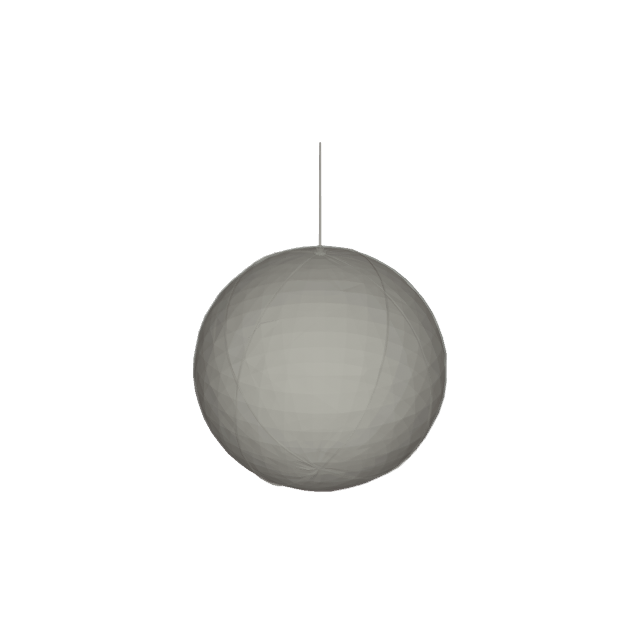 | `gen-pendant-lamp-sphere-1` | Pendant lamp (spherical white pendant, spun web shade) | lighting | 474 x 471 x 640 | `polycarbonate-opal` | 4,153 |
| 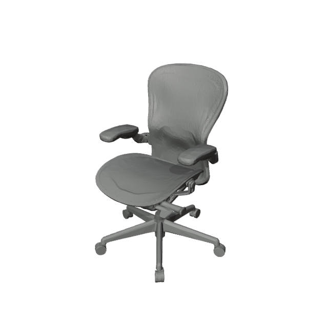 | `gen-task-chair-mesh-ergonomic-1` | Office chair (ergonomic mesh task chair, adjustable arms) | seating | 823 x 804 x 1080 | `rubber-black` | 79,997 |
| 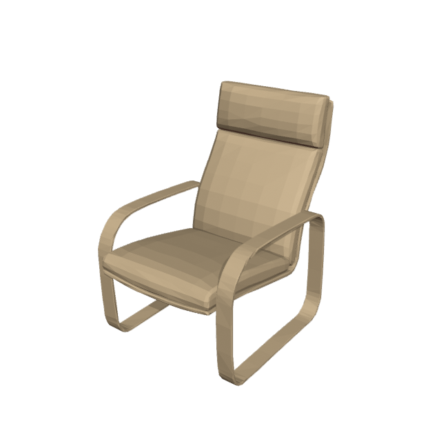 | `gen-armchair-cantilever-bentwood-1` | Armchair (cantilevered bent-wood armchair with thick cushion) | seating | 691 x 912 x 1000 | `wood-birch-ply` | 4,368 |
| 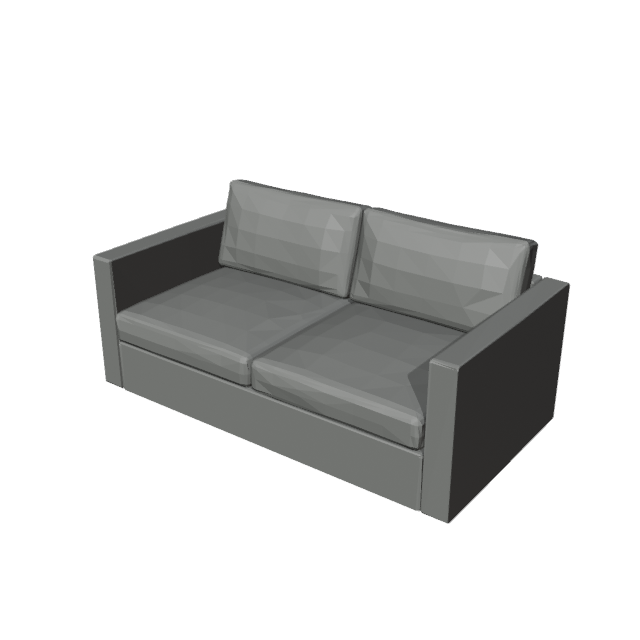 | `gen-sofa-2-seat-loose-cover-1` | Sofa (boxy two-seat sofa with loose fabric cover) | seating | 1405 x 752 x 660 | `rubber-black` | 4,301 |
| 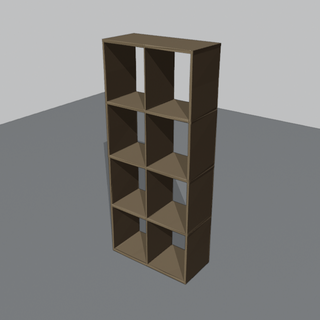 | `gen-shelving-cube-2x4-1` | Shelving unit (open cube shelving, 2 by 4) | storage | 626 x 293 x 1470 | `wood-birch-ply` | 4,203 |
| 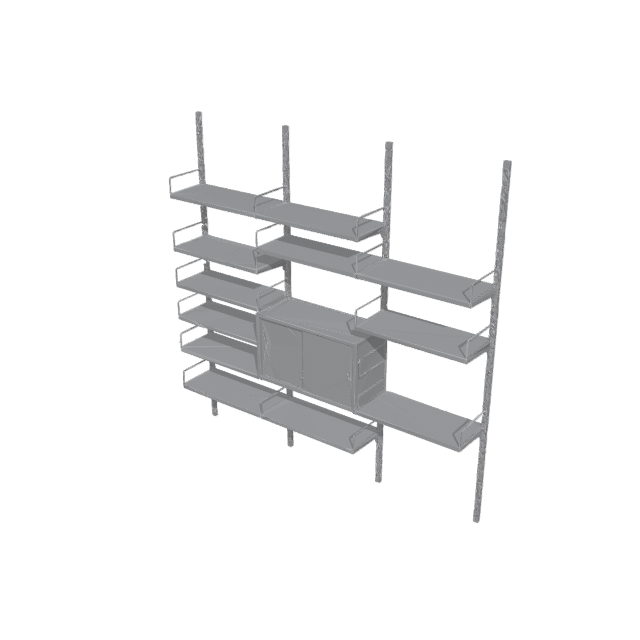 | `gen-shelving-modular-track-1` | Shelving system (wall-mounted modular shelving on aluminium tracks) | storage | 1966 x 313 x 2000 | `aluminium-anodized` | 79,999 |
| 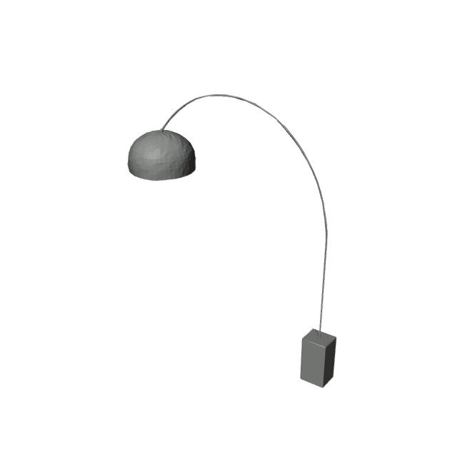 | `gen-floor-lamp-arc-1` | Floor lamp (arc floor lamp on a marble base) | lighting | 2180 x 621 x 2400 | `steel-galvanized` | 4,271 |
| 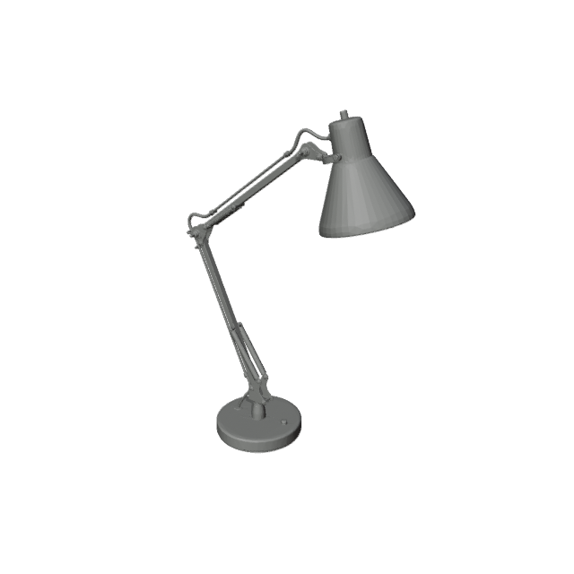 | `gen-task-lamp-balanced-arm-1` | Task lamp (two-arm balanced desk lamp) | lighting | 321 x 116 x 450 | `aluminium-anodized` | 80,000 |
| 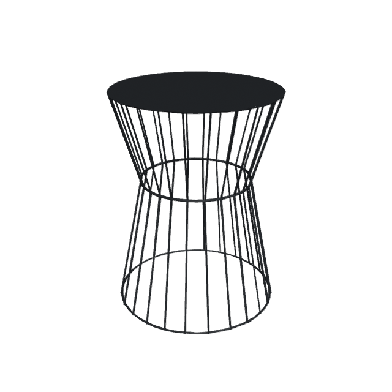 | `gen-side-table-wire-1` | Side table (stacking wire side table) | table | 378 x 378 x 500 | `steel-painted-charcoal` | 4,235 |

## Ginkgo props (batch `ginkgo-refset-1024`)

Sixteen building-services, household and interior props first generated for the
owner's Ginkgo world pass `refset_1024` (24 October 2026). Each has an original
single-object prompt, rendered as a reference image by Higgsfield `gpt_image_2_5`.
That image was then uploaded to Meshy 7.1 image-to-3D (PBR, 4K). Blender re-derived
library editions from the dense Meshy downloads: 40k triangles for simple hard-surface
pieces, 80k for the rest. The provider textures are removed and Almond materials
assigned. Heights are the real-world sizes authored in Ginkgo's scene scripts. Wall
pieces (water heater, gas meter, meter board) and countertop pieces (kettle, lamp) carry
the mount heights used in those scenes.

`batches/ginkgo-refset-1024.json` keeps the exact prompts, settings and IDs.
`batches/ginkgo-refset-1024/` keeps the per-asset request records and the reference
images Meshy received. Meshy got each image as a file upload, so the evidence links
the two stages by the image's SHA-256 rather than by a task ID.
`tools/stage_ginkgo_batch.py` rebuilt the raw records from the Ginkgo session's own
tool calls, and `tools/import_organic_batch.py` imported them.

Not included: Ginkgo's Tripo-generated condenser, the assembled W063–W066 scenes (paid
GRANDWHIS products), and meshes Ginkgo discarded. See `docs/licensing-audit.md`.

| Preview | asset_id | Product | Category | W x D x H (mm) | Material | Triangles |
| --- | --- | --- | --- | --- | --- | --- |
| 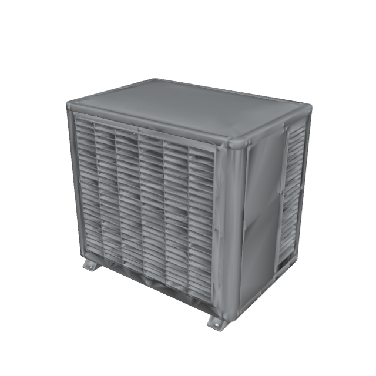 | `gen-ac-condenser-louvred-1` | Air-conditioner outdoor unit (older louvred-grille condenser, weathered) | building_services | 774 x 560 x 720 | `steel-galvanized` | 80,000 |
| 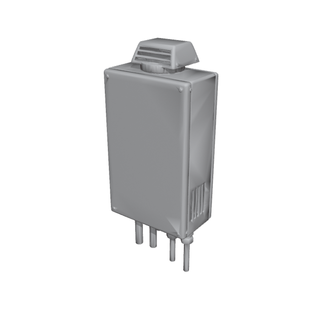 | `gen-water-heater-tankless-1` | Tankless gas water heater (wall-mounted, with pipe stubs) | building_services | 252 x 160 x 620 | `aluminium-anodized` | 40,000 |
| 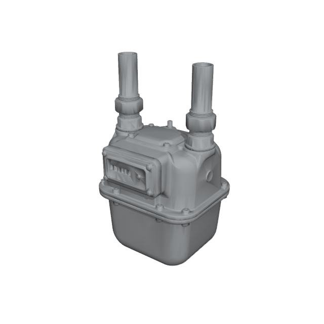 | `gen-gas-meter-1` | Gas meter (residential diaphragm meter with riser pipes) | building_services | 275 x 261 x 480 | `steel-galvanized` | 40,000 |
|  | `gen-electric-meter-board-1` | Electric meter board (five glass-domed meters on a steel board) | building_services | 1252 x 176 x 630 | `aluminium-anodized` | 80,000 |
|  | `gen-bin-galvanized-1` | Galvanised refuse bin (dented, lid askew) | site_furniture | 548 x 538 x 780 | `steel-galvanized` | 80,000 |
|  | `gen-garden-hose-coil-1` | Garden hose (loose coil lying flat, with nozzle) | household | 518 x 610 x 110 | `rubber-black` | 80,000 |
|  | `gen-mop-broom-bundle-1` | Mop and broom (string mop and broom leaning together) | household | 656 x 434 x 1350 | `wood-oak` | 80,000 |
|  | `gen-potted-plant-terracotta-1` | Potted houseplant (small terracotta pot) | vegetation | 465 x 417 x 450 | `foliage-pine` | 80,000 |
|  | `gen-refuse-bag-1` | Refuse bag (tied translucent plastic bag) | household | 578 x 377 x 620 | `polycarbonate-opal` | 79,998 |
|  | `gen-laundry-basket-1` | Laundry basket (perforated plastic basket heaped with clothes) | household | 645 x 523 x 500 | `plaster-white` | 80,000 |
|  | `gen-bed-low-duvet-1` | Low bed (light timber frame with rumpled duvet) | bed | 1408 x 1999 x 530 | `fabric-linen` | 80,000 |
|  | `gen-chest-of-drawers-pine-1` | Chest of drawers (three-drawer knotty pine) | storage | 921 x 520 x 850 | `wood-oak` | 80,000 |
|  | `gen-electric-kettle-1` | Electric kettle (plastic jug kettle on power base) | appliance | 240 x 195 x 260 | `plaster-white` | 40,000 |
|  | `gen-house-slippers-1` | House slippers (pair of open-toe rubber slippers) | household | 239 x 292 x 90 | `rubber-black` | 39,998 |
|  | `gen-table-lamp-pleated-1` | Table lamp (pleated paper shade on a brass stem) | lighting | 282 x 283 x 460 | `fabric-linen` | 80,000 |
|  | `gen-washing-machine-front-1` | Washing machine (compact front-loading) | appliance | 609 x 524 x 850 | `plaster-white` | 80,000 |

## Ginkgo batches of 2026-11-18 (mesh bank, Freiburg, refset_1118)

Eighteen more meshes from the owner's Ginkgo project, released under CC BY 4.0 with the
owner's approval on 2026-11-18. They were staged by `tools/stage_ginkgo_chains.py` from the
Ginkgo sessions' own tool calls and imported with `tools/import_organic_batch.py`. As with
refset_1024, Blender re-derived untextured library editions (40k to 80k triangles; 140k for
the shrub clump, whose thousands of separate leaves stop collapse decimation there). Provider
textures are removed and Almond materials assigned. The Freiburg ornaments and the three Tripo
meshes had edges shared by more than two faces; those edges were split, and the counts are in
each asset's `topology_repairs`.

**`ginkgo-meshbank-2026-11`**: cafe and street props Ginkgo generated for its shared mesh bank
(Meshy text-to-image, then Meshy 7.1). Heights are the real-world sizes stored with each prop.

| Preview | asset_id | Product | Category | W x D x H (mm) | Material | Triangles |
| --- | --- | --- | --- | --- | --- | --- |
|  | `gen-bistro-chair-rattan-1` | Bistro chair (French cafe chair, bent rattan frame, woven two-tone seat and back) | seating | 524 x 588 x 880 | `wood-oak` | 40,000 |
|  | `gen-bistro-table-marble-1` | Bistro table (Round marble top on a cast-iron pedestal) | table | 688 x 686 x 730 | `plaster-white` | 40,000 |
|  | `gen-cafe-parasol-1` | Cafe parasol (Open square canvas parasol, wooden pole, concrete base) | site_furniture | 2584 x 2590 x 2700 | `fabric-linen` | 40,000 |
|  | `gen-olive-tree-potted-1` | Potted olive tree (Small olive tree in a terracotta pot) | vegetation | 884 x 819 x 1800 | `foliage-pine` | 80,000 |
|  | `gen-street-lamp-cast-iron-1` | Street lamp (Traditional cast-iron post with a four-sided glass lantern) | site_furniture | 864 x 850 x 4000 | `steel-painted-charcoal` | 40,000 |
|  | `gen-bicycle-city-basket-1` | Bicycle (Step-through city bicycle with wicker basket and rear rack) | vehicle | 610 x 1678 x 1100 | `steel-painted-charcoal` | 60,000 |
|  | `gen-person-standing-coat-1` | Person standing (Adult pedestrian in a camel coat and scarf) | human_figure | 603 x 375 x 1800 | `plaster-white` | 60,000 |

**`ginkgo-freiburg-2026-11`**: stone ornament and fountain sculpture from Ginkgo's Freiburg
photo reconstructions. Meshy image-to-image received crops of the owner's own photographs; the
photographs are hashed in the evidence and not distributed. Sizes are as measured from those
photographs; the console and cartouche carry the wall heights at which the scene placed them.
These six use the new `ornament` category.

| Preview | asset_id | Product | Category | W x D x H (mm) | Material | Triangles |
| --- | --- | --- | --- | --- | --- | --- |
|  | `gen-statue-knight-gothic-1` | Statue (Gothic fountain figure: knight in plate armour on a corbel pedestal) | ornament | 368 x 328 x 1200 | `plaster-white` | 60,000 |
|  | `gen-statue-saint-staff-gothic-1` | Statue (Gothic fountain figure: robed saint holding a staff) | ornament | 207 x 187 x 740 | `stone-granite-paving` | 60,000 |
|  | `gen-statue-bishop-gothic-1` | Statue (Gothic fountain figure: bishop saint with mitre and book) | ornament | 212 x 173 x 720 | `stone-granite-paving` | 60,000 |
|  | `gen-gothic-tabernacle-canopy-1` | Tabernacle canopy (Gothic fountain-column canopy with pinnacles, spire and finial cross) | ornament | 656 x 668 x 1710 | `brick-red` | 80,000 |
|  | `gen-scroll-console-corbel-1` | Console (S-scroll balcony corbel with acanthus leaf) | ornament | 696 x 496 x 850 | `plaster-white` | 79,063 |
|  | `gen-cartouche-shell-scroll-1` | Cartouche (Baroque shell-and-scroll relief on a backing plate) | ornament | 841 x 98 x 700 | `plaster-white` | 78,569 |

**`ginkgo-refset-1118`**: hero props of the refset_1118 world pass. Higgsfield `gpt_image_2_5`
reference images (each conditioned on one of the owner's own concept images), then Meshy 7.1
(palm, shrub clump) or Tripo H3.1 through Higgsfield (taxi, refuse truck, vending machine). The
Tripo meshes are linked to their image by the job ID they were given. Vehicles are scaled by
length; the vending machine's front faces +X.

| Preview | asset_id | Product | Category | W x D x H (mm) | Material | Triangles |
| --- | --- | --- | --- | --- | --- | --- |
|  | `gen-taxi-sedan-1` | Taxi (Sedan taxi with blank roof sign) | vehicle | 2194 x 4698 x 1790 | `steel-painted-vermilion` | 59,991 |
|  | `gen-refuse-truck-rear-loader-1` | Refuse truck (Cab-over rear-loader compactor, plain white) | vehicle | 2994 x 8594 x 3540 | `plaster-white` | 59,997 |
|  | `gen-vending-machine-drinks-1` | Vending machine (Street drink vending machine, unbranded) | site_furniture | 823 x 981 x 1830 | `ceramic-teal` | 39,999 |
|  | `gen-palm-tree-1` | Palm tree (Young fan palm with a curved ringed trunk) | vegetation | 5552 x 5229 x 6400 | `foliage-pine` | 80,000 |
|  | `gen-shrub-clump-tropical-1` | Shrub clump (Dense tropical shrubs and ferns on a soil patch) | vegetation | 1549 x 1366 x 1000 | `foliage-pine` | 140,000 |

Not included: the Freiburg scenes' people, bicycles and lamp (scene-baked copies of older
meshes; the mesh-bank originals are above), procedural buildings and code-grown palms, and the
assembled GRANDWHIS scenes. See `docs/licensing-audit.md`.

## Project Y2K props (three batches, 2026-11-20)

Twelve meshes the owner used in the Project Y2K game, released under CC BY 4.0 with the owner's
approval on 2026-11-20 (operatives, bosses, weapons and buildings excluded). All were generated
in the owner's Ginkgo sessions, staged by `tools/stage_ginkgo_chains.py` from those sessions' tool
calls and imported with `tools/import_organic_batch.py`. Provider textures are removed and Almond
materials assigned. Heights are the sizes the game used. Two of the batches are Meshy
**text-to-3D** (preview + refine): they have no reference image, so their evidence keeps the
preview and refine requests and no image (see `docs/generation-source-documentation.md`).

**`y2k-props-v038`**: street clutter Ginkgo generated for pass refset_0923 (Meshy-6 text-to-3D,
remeshed by Meshy to 14k to 23k triangles, kept at that density) and Y2K reused unchanged.

| Preview | asset_id | Product | Category | W x D x H (mm) | Material | Triangles |
| --- | --- | --- | --- | --- | --- | --- |
|  | `gen-refuse-bag-heap-1` | Refuse bag heap (tied black and grey bin bags with crushed cans and paper scraps) | household | 1516 x 1443 x 720 | `rubber-black` | 20,630 |
|  | `gen-cardboard-box-stack-1` | Cardboard box stack (worn, crushed corrugated boxes with an open flap on top) | household | 482 x 526 x 1300 | `wood-oak` | 13,928 |
|  | `gen-ivy-clump-1` | Ivy clump (ivy and vines draped over a low wall block, stones at the base) | vegetation | 1634 x 1508 x 1600 | `foliage-pine` | 23,170 |
|  | `gen-rubble-pile-1` | Rubble pile (low heap of broken brick, tile shards, concrete chunks and a pallet plank) | landscape | 1837 x 1820 x 282 | `brick-red` | 20,457 |

**`y2k-trees-refset-0923b`**: Higgsfield `gpt_image_2_5` images from text prompts, uploaded to
Meshy-7 image-to-3D (remeshed by Meshy to about 24k triangles, kept at that density).

| Preview | asset_id | Product | Category | W x D x H (mm) | Material | Triangles |
| --- | --- | --- | --- | --- | --- | --- |
|  | `gen-tree-maple-red-1` | Japanese maple tree (red-leaf, curving trunk, layered airy crown) | vegetation | 5593 x 4816 x 6500 | `foliage-pine` | 23,312 |
|  | `gen-tree-broadleaf-green-1` | Broadleaf tree (mature zelkova or elm type with flared roots and a vase-shaped crown) | vegetation | 7158 x 4060 x 7000 | `foliage-pine` | 24,546 |

**`y2k-twofronts-2026-09`**: Y2K retro-futurist props and speculative vehicles from the game's
first Meshy rounds (Meshy-6 text-to-3D, downloaded as OBJ). Blender imported the OBJ geometry
(250k to 860k triangles) and decimated it to 40k to 60k. Fronts face -Y; the scooter and car
run along X. The holo sign's disc carries raised "Y2K" lettering that Meshy added despite the
prompt; the scooter has small wheels the prompt did not ask for.

| Preview | asset_id | Product | Category | W x D x H (mm) | Material | Triangles |
| --- | --- | --- | --- | --- | --- | --- |
|  | `gen-planter-pod-capsule-1` | Planter pod (glossy bowl planter on a ring base with a stylised round-leaf plant) | site_furniture | 703 x 773 x 1100 | `polycarbonate-opal` | 49,994 |
|  | `gen-vending-machine-capsule-1` | Vending machine (rounded capsule with a bubble window of drink capsules, unbranded) | site_furniture | 972 x 973 x 2400 | `polycarbonate-opal` | 49,997 |
|  | `gen-kiosk-pod-1` | Kiosk pod (egg-shaped street kiosk with a porthole serving window on a pedestal) | site_furniture | 1376 x 1467 x 2600 | `polycarbonate-opal` | 39,999 |
|  | `gen-holo-sign-pod-1` | Holo sign pod (sphere sign on a slim stalk, raised "Y2K" lettering) | site_furniture | 1680 x 1412 x 3400 | `aluminium-anodized` | 39,999 |
|  | `gen-hover-scooter-1` | Hover scooter (bubble scooter with a ball front wheel and a small rear wheel) | vehicle | 1282 x 970 x 1200 | `polycarbonate-opal` | 50,000 |
|  | `gen-hover-car-bubble-1` | Hover car (egg-shaped two-seat bubble car on a hover skirt, no wheels) | vehicle | 2826 x 2111 x 1600 | `polycarbonate-opal` | 59,999 |

Not included: Y2K's operatives, their drones and the bosses, the needle pistol, the pod building,
Ginkgo's unused `tree_green_wild`, and every remeshed, merged or conditioned derivative. See
`docs/licensing-audit.md`.

## Ginkgo props reused in Project Y2K (four batches, 2026-11-20)

Thirteen Ginkgo props that Project Y2K content v061 conditioned and placed in its Mirai Ward hub
(`twofronts/meshy/ginkgo_props_v061`), released under CC BY 4.0 with the owner's approval on
2026-11-20 (the owner chose this group the same day). One batch per Ginkgo pass and route; all
were staged by `tools/stage_ginkgo_chains.py` from the Ginkgo sessions' tool calls and imported
with `tools/import_organic_batch.py`. Provider textures are removed and Almond materials
assigned; Blender re-derived 50k to 80k-triangle editions (125k for the flower clump, whose
separate petals stop collapse decimation near 120k) and split edges shared by more than two
faces (counts in `topology_repairs`). Vehicles carry Project Y2K's lengths; the other props have
real-world sizes chosen for this import rather than the stylised scene sizes (each batch's
`dimension_basis`). The refset_1003 and refset_1007 prompts were written from owner reference
sets of third-party photographs; every generated image was compared with them and the comparison
is in each asset's `reference_review` (see `docs/licensing-audit.md`).

**`ginkgo-refset-1003`**: Higgsfield `gpt_image_2_5` images from text prompts, uploaded to Meshy-7 image-to-3D (remeshed by Meshy to about 100k triangles). Sizes are real-world choices (Y2K used 1.35 m for the bladder and 1.25 m for the canister).

| Preview | asset_id | Product | Category | W x D x H (mm) | Material | Triangles |
| --- | --- | --- | --- | --- | --- | --- |
|  | `gen-lounge-chair-inflatable-cushion-1` | Lounge chair (low lounge chair with quilted inflatable seat and round back cushions strapped to a bolted perforated-angle, aluminium-extrusion and timber-block frame) | seating | 679 x 923 x 900 | `fabric-linen` | 59,998 |
|  | `gen-water-bladder-strapped-1` | Water bladder (upright quilted collapsible water container with screw cap, carry handle, two webbing straps with buckles and a bottom spout) | household | 402 x 254 x 450 | `polycarbonate-opal` | 49,977 |
|  | `gen-pressure-canister-1` | Pressure canister (upright painted-steel pressure canister with top valve lever, hose and nozzle, two shackles at the valve guard and a blank instruction panel) | building_services | 451 x 245 x 650 | `steel-galvanized` | 59,995 |

**`ginkgo-refset-1007`**: Higgsfield `gpt_image_2_5` reference images, each conditioned on one of the pass's text-only concept images (named and hashed in `concept_reference`), then Tripo H3.1 through Higgsfield (about 1.9M triangles; water tanks, rover, tram, drone, launcher, shuttle) or Meshy-7.1 (7.6M to 7.8M triangles; planter box, flower clump). Vehicles are scaled by Project Y2K's lengths. The launcher is a drone launch and service vehicle (crane boom and ramps), not a weapon; the shuttle has no landing gear.

| Preview | asset_id | Product | Category | W x D x H (mm) | Material | Triangles |
| --- | --- | --- | --- | --- | --- | --- |
|  | `gen-water-tanks-rooftop-pair-1` | Rooftop water tanks (pair of vertical stainless water tanks with conical tops on a braced galvanised stand, with ladder and valved pipework) | building_services | 1283 x 2878 x 3000 | `steel-galvanized` | 79,999 |
|  | `gen-rover-six-wheel-1` | Exploration rover (six-wheeled armoured exploration rover with wraparound cab windows, roof sensor mast, antennas and dish, big knobbly tyres) | vehicle | 5398 x 2944 x 4084 | `plaster-white` | 79,998 |
|  | `gen-capsule-tram-overgrown-1` | Capsule tram car (abandoned rounded capsule tram car with windscreen, porthole, sliding side door, open roof hatch, vines and moss, on a low bogie frame) | vehicle | 5269 x 9003 x 4160 | `plaster-white` | 79,999 |
|  | `gen-drone-quadcopter-1` | Quadcopter drone (toy-like rounded quadcopter with camera eye, four propeller arms and short landing legs) | vehicle | 1309 x 1401 x 454 | `ceramic-teal` | 59,999 |
|  | `gen-drone-launcher-vehicle-1` | Drone launcher vehicle (chunky rounded wheeled service vehicle with a folding crane boom on top and two fold-out ramp wings) | vehicle | 1861 x 3201 x 2205 | `ceramic-teal` | 79,999 |
|  | `gen-shuttle-craft-1` | Shuttle craft (compact wedge-hulled sci-fi shuttle with swept wings, twin rear engine pods and a small canopy) | vehicle | 11997 x 11991 x 3171 | `steel-painted-charcoal` | 80,000 |
|  | `gen-planter-box-galvanised-1` | Planter box (long galvanised corrugated-metal planter trough overflowing with leafy plants, herbs, tomatoes and trailing vines) | vegetation | 1899 x 613 x 782 | `steel-galvanized` | 80,000 |
|  | `gen-flower-clump-magenta-1` | Flower clump (dense clump of magenta flower spikes and pink daisy-like blooms on leafy stems, on a small soil base) | vegetation | 718 x 690 x 600 | `foliage-pine` | 124,998 |

**`ginkgo-refset-0924`**: a generic classical plaster statue (Higgsfield image from a text prompt, Meshy-7), life-size on its plinth (the Ginkgo and Y2K scenes used 2.4 m).

| Preview | asset_id | Product | Category | W x D x H (mm) | Material | Triangles |
| --- | --- | --- | --- | --- | --- | --- |
|  | `gen-statue-plaster-togate-1` | Plaster statue (classical white plaster statue of a standing robed figure holding a scroll, on a chipped square plinth) | ornament | 640 x 582 x 2000 | `plaster-white` | 80,000 |

**`ginkgo-lausanne-market`**: a shop dress form, Meshy-6 text-to-3D (no image stage; the refine request named no model, recorded as unspecified).

| Preview | asset_id | Product | Category | W x D x H (mm) | Material | Triangles |
| --- | --- | --- | --- | --- | --- | --- |
|  | `gen-dress-form-mannequin-1` | Dress form (shop dress form on a wooden tripod stand, wearing a summer sundress) | household | 540 x 481 x 1720 | `fabric-linen` | 60,000 |

Not included: the refset_1003 pack unit and cube rover (close to specific third-party designs in the owner's references) and lander (replica of a reference artwork), the refset_1007 AC unit and habitat module, the Lausanne bike, pigeon and figures, the inflatable bear, and every LOD or Y2K `SM_GK61` derivative. See `docs/licensing-audit.md`.

## Project Y2K procedural kit pieces (four batches, 2026-11-20)

Thirty low-poly pieces (176 to 2,084 triangles) that Blender scripts in the owner's Project Y2K game repository built and exported as FBX: route `procedural_script`, the library's first geometry with no generation provider, prompt or image. Released under CC BY 4.0 with the owner's approval on 2026-11-20 (the owner chose this group the same day). `tools/stage_ginkgo_chains.py` checked each script, kit record and FBX against the hashes in the batch and retained the scripts and kit records as text in `batches/<batch>/` (local absolute paths redacted); `tools/prepare_organic_meshes.py` imported the FBX at its authored metre size, removed collision hulls and the recorded edits, and kept the triangle count (no decimation, no subdivision, hard edges kept); `tools/import_organic_batch.py` imported them. Sizes are the authored kit sizes. Kit colours and textures are not shipped; each piece carries one Almond material. Each script's authoring session (or that none was found) is in its batch record (see `docs/generation-source-documentation.md`).

**`y2k-street-kit-v004`**: street furniture from `build_street_kit.py` (street kit v004, 2026-09-11). No session that wrote this script was found (the retained transcripts start a day later), so its authorship is recorded as not found. The lamp, kiosk and arch carried tessellated lettering ("01", "RELAY" / "ACCESS", "NEON GATEWAY"); it is removed as a recorded edit and the panels are blank.

| Preview | asset_id | Product | Category | W x D x H (mm) | Material | Triangles |
| --- | --- | --- | --- | --- | --- | --- |
|  | `gen-bench-street-slab-1` | Street bench (rounded slab seat on two block supports, 2.4 m) | site_furniture | 2400 x 700 x 660 | `concrete-smooth` | 564 |
|  | `gen-street-lamp-wayfinding-1` | Street lamp (5 m lamp with an arched arm and a blank wayfinding panel) | site_furniture | 1600 x 650 x 5010 | `aluminium-anodized` | 908 |
|  | `gen-info-kiosk-capsule-1` | Information kiosk (rounded capsule totem with a blank screen, 2.7 m) | site_furniture | 1350 x 965 x 2700 | `plaster-white` | 532 |
|  | `gen-planter-sculpted-shrubs-1` | Street planter (rounded planter with three sculpted shrub forms, 2.6 m) | site_furniture | 2600 x 1120 x 1770 | `concrete-smooth` | 2,084 |
|  | `gen-gateway-arch-street-1` | Street gateway arch (10.7 m arch on two piers with a blank sign band) | site_furniture | 10700 x 835 x 6360 | `concrete-smooth` | 720 |

**`y2k-district-kit-v016`**: market and yard props from `build_district_kit_v016.py` (Y2K session d8e0ca86, 2026-09-18).

| Preview | asset_id | Product | Category | W x D x H (mm) | Material | Triangles |
| --- | --- | --- | --- | --- | --- | --- |
|  | `gen-market-stall-counter-1` | Market stall counter (painted counter with a metal top, front panels and legs, 2.4 m) | site_furniture | 2600 x 1050 x 1070 | `steel-painted-sage` | 276 |
|  | `gen-market-stall-awning-1` | Market stall awning (sloped canopy on two posts with a valance and a bulb string, 3.2 m) | site_furniture | 3200 x 1898 x 2600 | `fabric-linen` | 264 |
|  | `gen-crate-stack-banded-1` | Crate stack (three stacked crates with metal bands, 1.8 m) | household | 916 x 887 x 1780 | `wood-oak` | 396 |
|  | `gen-produce-bin-1` | Produce bin (low metal market bin with a filled top and side handles, 1.1 m) | site_furniture | 1200 x 700 x 590 | `steel-galvanized` | 272 |
|  | `gen-barrel-steel-1` | Steel barrel (ribbed drum, 0.6 m diameter, 0.9 m) | household | 610 x 610 x 930 | `steel-painted-vermilion` | 416 |
|  | `gen-shipping-container-1` | Shipping container (6 m (20 ft class) container, doors closed) | site_furniture | 6200 x 2460 x 2610 | `metal-corrugated` | 1,292 |
|  | `gen-shipping-container-open-1` | Shipping container, doors open (6 m (20 ft class) container with both doors swung open) | site_furniture | 6786 x 3610 x 2610 | `metal-corrugated` | 1,248 |
|  | `gen-bollard-banded-1` | Banded bollard (steel bollard with reflective bands, 1.0 m) | site_furniture | 340 x 340 x 1040 | `steel-painted-charcoal` | 348 |
|  | `gen-fence-panel-mesh-1` | Mesh fence panel (3 m panel between two posts with top and bottom rails, 2.4 m) | site_furniture | 3114 x 120 x 2400 | `steel-mesh` | 228 |
|  | `gen-floodlight-mast-1` | Floodlight mast (6 m mast with three floodlight heads) | site_furniture | 1300 x 867 x 6310 | `steel-galvanized` | 568 |
|  | `gen-antenna-mast-beacon-1` | Antenna mast (5 m guyed-look antenna mast with a beacon) | building_services | 1014 x 900 x 5320 | `steel-galvanized` | 468 |
|  | `gen-sign-mast-lit-1` | Sign mast (3.4 m mast with an arm and a blank lit panel) | site_furniture | 1870 x 155 x 3400 | `steel-painted-charcoal` | 212 |
|  | `gen-air-handler-1` | Air handler (packaged air-handling unit on a base, 2.0 m) | building_services | 2006 x 1500 x 1380 | `steel-galvanized` | 352 |
|  | `gen-pipe-run-stands-1` | Pipe run on stands (4 m run of parallel pipes on support stands) | building_services | 4000 x 1200 x 1800 | `steel-galvanized` | 288 |

**`y2k-megastructure-kit-v020`**: facade and rooftop services from `build_megastructure_kit_v020.py` (Y2K session 46dbb3db, 2026-09-19). The kit was designed with six third-party reference images the owner supplied in view (hashed, not retained); these pieces are generic box-and-tube assemblies. The AC stack and pipe riser are wall-mounted (assumed mount heights 2.5 m and 0).

| Preview | asset_id | Product | Category | W x D x H (mm) | Material | Triangles |
| --- | --- | --- | --- | --- | --- | --- |
|  | `gen-satellite-dish-1` | Satellite dish (3 m dish on a braced stand) | building_services | 3000 x 1906 x 3991 | `aluminium-anodized` | 176 |
|  | `gen-ac-unit-wall-stack-1` | Wall AC unit stack (two rows of three outdoor AC units on wall brackets) | building_services | 3251 x 540 x 1900 | `steel-galvanized` | 1,136 |
|  | `gen-pipe-bundle-vertical-1` | Vertical pipe bundle (12 m facade riser of pipes with clamps and conduit) | building_services | 1450 x 520 x 12000 | `steel-galvanized` | 236 |
|  | `gen-scaffold-bay-1` | Scaffold bay (tube-and-fitting scaffold bay with plank decks, 4 m wide, 9.2 m high) | building_services | 4052 x 1260 x 9196 | `steel-galvanized` | 312 |
|  | `gen-antenna-cluster-roof-1` | Rooftop antenna cluster (lattice mast with whip and panel antennas and dishes on a roof pad) | building_services | 8000 x 8000 x 15800 | `aluminium-anodized` | 1,176 |

**`y2k-world-kit-v040`**: Mirai Ward street details (`kit_v060_details.py`, Y2K session f2628003, 2026-10-10), the lantern shrine (`kit_v040.py`, Y2K sessions 09c7fb46 and 5772745b, 2026-09-26/27) and two commuter railcars (`kinetic_v046.py`, Y2K session 6e4feafa, 2026-10-01). Engine collision hulls are removed; the lead car's destination-board decal quad (a lettered texture) is removed as a recorded edit. Railcars run along X.

| Preview | asset_id | Product | Category | W x D x H (mm) | Material | Triangles |
| --- | --- | --- | --- | --- | --- | --- |
|  | `gen-utility-pole-1` | Utility pole (10.5 m concrete pole with crossarms, insulators, a transformer and a lamp arm) | site_furniture | 3525 x 600 x 10500 | `concrete-smooth` | 852 |
|  | `gen-vending-row-1` | Vending machine row (three street vending machines with lit fronts and a can bin) | site_furniture | 3920 x 860 x 1990 | `steel-painted-vermilion` | 252 |
|  | `gen-wall-ac-rig-1` | Wall AC rig (two split AC units on wall brackets with pipe runs and a drain line) | building_services | 2525 x 450 x 4130 | `steel-galvanized` | 354 |
|  | `gen-shrine-lantern-1` | Lantern shrine (plinth with a red gate frame, a hanging paper-lantern form and two offering boxes, 4 m) | ornament | 4000 x 4000 x 4020 | `steel-painted-vermilion` | 1,072 |
|  | `gen-commuter-railcar-lead-1` | Commuter railcar, lead (20 m car with a raked nose, window band, doors, roof units and a pantograph) | vehicle | 19750 x 3060 x 5420 | `plaster-white` | 768 |
|  | `gen-commuter-railcar-mid-1` | Commuter railcar, middle (20 m middle car with a window band, doors, roof units and a pantograph) | vehicle | 19700 x 3060 x 5420 | `plaster-white` | 680 |

Not included: the drain grate, square pillar (duplicate of `gen-column-square-1`), catwalk and stair (retired stair/railing family), overhead cable, the blank 48-triangle neon sign, the blimp, cargo airship, ad balloon and sign drone (billboard textures may show operatives), the sky gondola and cable, the ten Chinese neon signs (lettering from system fonts), game pickups, jump pad, parkour and FX meshes, and every building-scale, wall, ground or road module. See `docs/licensing-audit.md`.

## Batch 2: design-idiom furniture and lighting

The second batch (ids with `batch: 2` in the catalogue) describes design language
rather than products: Scandinavian bent birch, American mid-century moulded
plywood and shell seating, democratic-design staples, Italian lighting. Prompts
never name a brand or product and ids stay generic, so the CC BY 4.0 release is
clean; treat them as placeholders in the idiom, not replicas. Concept images came
from Higgsfield (nano_banana); meshes from Meshy, with the complex pieces on
Meshy 7 ultra and decimated to about 80k triangles.

## Regenerating or extending

1. Add or edit an entry in `catalogue.json` (keep `asset_id` stable; bump the
   trailing number for a new variant).
2. Generate with Meshy following `generation_recipe` in the catalogue:
   `meshy_text_to_image` (nano-banana, prompt + `prompt_suffix`) then
   `meshy_image_to_3d` chained on that task (`meshy-t2`, `smart-topology`,
   `should_texture=false`, `target_formats=["glb"]`, `auto_size`, `origin_at=bottom`).
   About 8 credits per asset.
3. Save the GLB as `raw/<asset_id>.glb` and record both task ids in
   `provenance.json`.
4. Run `python tools/build_generated_assets.py` (optionally `--only <id>`),
   then `pytest tests/test_generated_assets.py`.
5. Note the change in `docs/licensing-audit.md` if the recipe or licence
   position changes.

Quality notes: most meshes are untextured smart-topology output at roughly 4k
triangles; the two trees are meshy-7 ultra output decimated to 80k triangles (see
`tools/decimate_glb.py`) - right for entourage, plans, sections and massing, not for
close-up renders. Plan-dimension deviations above 25% are flagged in the
build log; the measured values are what the manifest stores.

### Coloured archive previews (rc.8)

The 47 individual thumbnails now use the embedded GLB material base colours,
with paint.sl studio lighting and a transparent background. They are material
studies, not photographic textures or full PBR renders. Model geometry,
materials, embedded passports and derived drawings are unchanged. Existing
contact sheets are legacy renders.

Regenerate with `blender --factory-startup -b --python tools/render_generated_previews.py -- GeneratedAssetfiles/models GeneratedAssetfiles/previews --archive`.
`--clay` is an optional neutral study; `--asset <asset_id>` renders a single
inspection sample into a separate output folder. The full archive needs all
84 records. `previews/render-record.json` records Blender/version/settings,
script checksum (LF-normalized), and each source GLB and rendered PNG checksum.
This is a post-generation preview derivation, not a change to Meshy history.

## Organic detail batch (rc.12)

Three approved neutral assets cover forms that are inconvenient to build from
primitives: a weathered boulder, driftwood and a loosely folded throw. The public collection contains geometry
editions with Almond material colours, not photographic texture atlases.

The batch uses Meshy's nano-banana-pro reference images and Meshy 7.1 standard
generation at 4k geometry resolution, with provider remeshing disabled. Dense
source GLBs remain in the local, gitignored `raw/organic-2026-09/` directory.
Blender derives library versions targeting 80k–120k triangles without
subdivision. Select **Original** in Rhino to place that full library mesh;
**Light** remains an optional 20k placement target.

`batches/organic-2026-09.json` preserves the original prompts and requested
settings. Per-asset records and retained generated input images live under
`batches/organic-2026-09/`. Embedded passports retain task IDs, timestamps,
input/output hashes, actual triangle counts and derivation/topology checks.
Unknown seeds remain null. No external design images were submitted. Heights
are authored study sizes; dimensions are not product specifications. Foliage
is generic entourage, not a certified botanical reconstruction.

Quality records report boundary and non-manifold edges, zero-area faces,
connected components and bounds changes. Visual inspection complements these
checks; self-intersections and fabrication suitability are not certified.

Five concepts were attempted in this batch. Only the three reviewed assets above
are included. The broad-frond plant failed the mesh/visual quality review; the
grass task was still processing at selection cutoff. Their trial files remain
in the local raw directory and are not part of the public pack.
