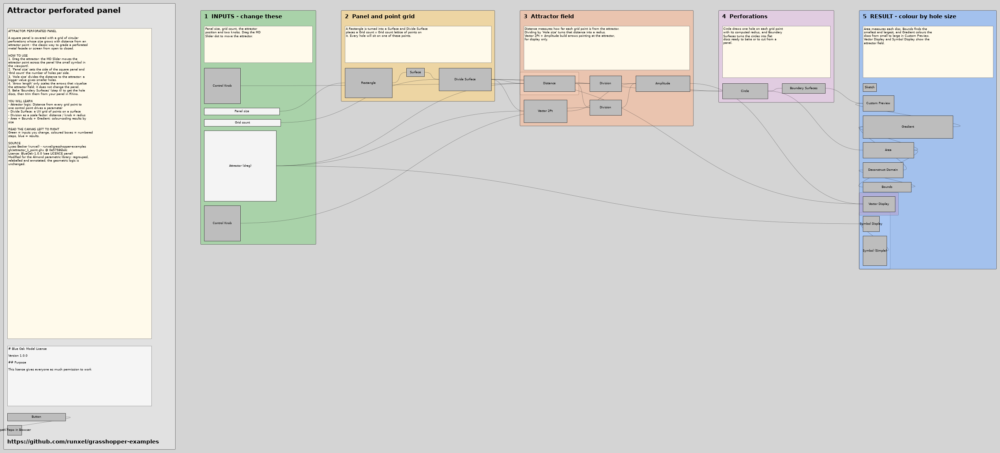

# Almond parametric library

Teaching versions of openly licensed, architectural Grasshopper definitions.
Each definition is the upstream author's file with its **logic unchanged**,
reorganised so a student can read it left to right and learn the technique.

| id | title | category | level | needs your geometry |
| --- | --- | --- | --- | --- |
| `facade-attractor-perforation` | Attractor perforated panel | facade | beginner | no |
| `facade-diagrid-on-surface` | Diagrid on a freeform surface | facade | beginner | optional (sample stored) |
| `facade-louvre-rotation` | Louvres rotated by length | facade | beginner | no |
| `facade-spiral-fins` | Rotating fin field (kinetic facade) | facade | intermediate | no |
| `facade-voronoi-screen` | Voronoi screen on a surface | facade | advanced (script) | optional (sample stored) |
| `structure-shell-roof-ribs` | Ribbed shell roof with diagonal bracing | structure | beginner | optional (sample stored) |
| `massing-twisted-star-tower` | Twisted star tower (loft massing) | massing | intermediate | no |
| `massing-twisting-polygon-tower` | Twisting polygon tower | massing | beginner | no |
| `site-terrain-from-levels` | Terrain from level curves | site | intermediate | optional (sample contours stored) |
| `landscape-paving-patterns` | Paving patterns with attractor colouring | landscape | intermediate | optional (attractor curve) |

All ten run on stock Rhino 8. Only the Voronoi screen contains a script: a
legacy GhPython component that runs Rhino's `_OffsetSrf` command, and only
while its toggle is on. Upstream saved that toggle on; this copy opens with it
off. That is the library's one value override, declared in the lesson and
recorded in the source register.

## Reading a definition

Open any `definitions/<id>.ghx` in Grasshopper (Rhino 8). The canvas reads left
to right:

| Block | Colour | What it holds |
| --- | --- | --- |
| **README** | grey | Title, what it models, numbered *how to use*, *you will learn*, source, licence and the author's credit button. |
| **1 INPUTS** | green | Every slider, toggle and geometry input, stacked in one column and given a meaningful name. |
| **2, 3, …** | warm colours | One numbered step each. A panel explains what the step does and why; components are arranged in columns by data-flow order. |
| **RESULT** | blue | Previews and the components to bake. |

`lessons/<id>.lesson.json` holds the same text in machine-readable form, along
with a list of concepts and the inputs. `catalogue.json` indexes all entries.
`previews/` holds the canvas layout rendered straight from the XML, with
nothing solved.

## What was changed, and what was not

The annotator (`tools/parametric_library/annotate_ghx.py`) makes these changes:

- **Moved:** objects are placed into stage blocks.
- **Relabelled:** nicknames are renamed where the lesson says so.
- **Added:** groups, step titles, explanation panels, a README panel and a
  LICENCE panel.
- **Removed:** original groups whose members ended up in different stages, and
  the original title scribbles the lesson lists as replaced.

It never adds, removes or rewires a component, and never changes internalised
geometry or a script. It changes a value only when the lesson declares an
`overrides` entry with a reason; currently that is the one Voronoi toggle. `logic_fingerprint.py` proves this for every
file: a hash of each component's settings, wires and data, ignoring only layout
and nicknames, must be identical to upstream once the declared overrides are applied. The test suite and
`--check` enforce it.

## Sources and licences

| Upstream | Licence | Files |
| --- | --- | --- |
| Lucas Becker, [runxel/grasshopper-examples](https://github.com/runxel/grasshopper-examples) @ `0e57586` | Blue Oak Model License 1.0.0 | 7 |
| Owen Derby, [oderby/VVD](https://github.com/oderby/VVD) @ `548fa53` | MIT | 1 |
| Nono Martínez Alonso, [nonoesp/GettingArchitectureDoneKit](https://github.com/nonoesp/GettingArchitectureDoneKit) @ `853a38c` | MIT | 1 |
| Brendan Harmon, [baharmon/computational-design-library](https://github.com/baharmon/computational-design-library) @ `3b49802` | MIT | 1 |

Each annotated file keeps the upstream licence text in its LICENCE panel.
`LICENSES/` keeps the same texts, and `upstream/` keeps the files exactly as
downloaded, plus the `.ghx` conversion for binary `.gh` files.
`source-register.json` records, for every item:

- the repo, commit, path, raw URL, author and access date;
- the upstream, converted and output SHA-256 hashes;
- each derivation step;
- the relabels and the dropped groups and notes.

The annotations, lesson files, catalogue and tooling are Almond's own (MIT).
The adapted definitions remain under their upstream licences.

## In Almond (MCP tools)

The wheel bundles the definitions, lessons, previews, licences, catalogue and
register; `upstream/` and the build tools ship only in the sdist. On first use
they are scaffolded to `%LOCALAPPDATA%\Almond\ParametricLibrary\releases\<version>`
(or set `RHINO_MCP_PARAMETRIC_DIR`).

| Tool / resource | What it does |
| --- | --- |
| `list_parametric_definitions(query, category, level)` | Search the catalogue by text, concept, category or level. |
| `get_parametric_definition(id)` | The lesson: how to use, concepts, every step with its explanation, inputs, scripts, source and licence, plus the local `.ghx` path. The file is checked against the register. |
| `open_parametric_definition(id)` | Opens the definition in Rhino's Grasshopper editor through the bridge. Only register-matching library files can be opened. |
| `almond://parametric/catalogue`, `almond://parametric/{id}/lesson`, `almond://parametric/{id}/preview` | The same data as resources; the preview is a PNG. |

`tools/verify_release.py` admits Grasshopper files to a wheel only as these
register-checked, permissively licensed definitions and their harnessed
capsules (below).

## Runnable capsules (harnessed derivatives)

A teaching definition is for reading. To let Almond *run* one with the same
intent, the build derives a second file from it: a **capsule**, the Almond
contract for executing a Grasshopper definition headless through the bridge
(`capsules/AUTHORING.md`, `run_gh_definition`). The harness is added at XML
level by `tools/parametric_library/harness_ghx.py`, driven by a `harness` block
in the lesson, so nothing is opened in Grasshopper and the result is
reproducible:

- one `ALMOND_IN_*` param per declared input, carrying the replaced slider's
  saved value, or the replaced geometry param's internalised sample, as its
  persistent data, so the file still solves on open;
- every wire that left the replaced slider or param is moved to the new param;
  the original stays on the canvas, disconnected;
- one `ALMOND_OUT_*` param per declared output, wired from the named component
  outputs; geometry outputs are baked by the bridge;
- a pink **ALMOND HARNESS** group with a note listing every replacement.

Because the originals stay in place, the derivation is checkable: dropping the
harness objects and mapping each harness param back onto the object it
replaces gives exactly the teaching file's logic fingerprint
(`logic_fingerprint.fingerprint(path, drop=, substitutions=)`). The build, the
test suite and `verify_release.py` all enforce it. `source-register.json`
records the step under `harnessed`: input and output hashes, the manifest
hash, each replacement, the rewired wire counts, the harness object GUIDs and
the substitution map.

| capsule_id | from | capability | inputs | outputs | audited |
| --- | --- | --- | --- | --- | --- |
| `parametric_shell_roof_ribs_v1` | `structure-shell-roof-ribs` | generate | `ALMOND_IN_BASE_SRF` (brep, sample stored), `ALMOND_IN_RIBS_U`, `ALMOND_IN_RIBS_V`, `ALMOND_IN_RIB_DEPTH`, `ALMOND_IN_BRACE_RADIUS` | `ALMOND_OUT_RIB_AXES`, `ALMOND_OUT_BRACE_AXES` (curve[]), `ALMOND_OUT_RIBS`, `ALMOND_OUT_BRACES` (brep[]) | no |

Files: `capsules/<id>.harnessed.ghx` and `capsules/<capsule_id>.capsule.json`.
All lengths are in the Rhino document's units; the upstream file was authored
in metres. The server registers these manifests next to `capsules/` only when
both files match the register, so a tampered copy is skipped loudly and
`get_parametric_definition` reports `capsule.integrity: FAILED`.

**Auditing.** `audited` is false until a human has solved the harnessed file
live, and `run_gh_definition` refuses it until then. To audit the shell roof:

1. Open `capsules/structure-shell-roof-ribs.harnessed.ghx` in Grasshopper
   (Rhino 8, a document in metres). It should solve on the stored sample.
   Hover each `ALMOND_OUT_*` param: the two axis params carry curves, the two
   solid params carry breps.
2. Reference your own single-face surface into `ALMOND_IN_BASE_SRF` and change
   the four numbers; confirm the roof follows.
3. Set `harness.audited` to `true` in `lessons/structure-shell-roof-ribs.lesson.json`
   (and record the run in `audit_note`), rebuild (`build_parametric_library.py`,
   then `--check`), restart the MCP client and run
   `run_gh_definition("parametric_shell_roof_ribs_v1", {...})` once with a
   referenced surface. Check that the baked ribs land as breps, not meshes: the
   bridge bakes through `GH_Convert`, which tries mesh before brep.
4. Then `validate_structure` on `ALMOND_OUT_RIB_AXES` + `ALMOND_OUT_BRACE_AXES`
   after assigning `almond:section` user text, as the 2026-10-20 stress test did
   by hand (`docs/research-2026-10-gh-stress-test.md`).

Known limit: the bridge scales *inputs* from document units into a port's
declared length unit but bakes outputs unscaled, which is why the library
capsules declare `document` units everywhere instead of `m`.

## Adding a definition

1. Find a source with a permissive licence (MIT, BSD, Apache-2.0, BlueOak, CC0,
   CC BY). Check the candidate list in
   `docs/reference/gh-library-candidates-2026-10.json` and the research notes in
   `docs/research-2026-10-grasshopper-libraries.md`. No licence means all
   rights reserved: excluded.
2. Download the file at a pinned commit into
   `upstream/<owner>__<repo>/<path>`, and its licence into
   `LICENSES/<owner>__<repo>.txt`. For a binary `.gh`, convert it:
   `powershell -File tools/parametric_library/gh_convert.ps1 -InputPath <file.gh> -OutDir <dir>`
   and store the `.ghx` beside it.
3. Read its data flow:
   `python tools/parametric_library/lesson_draft.py <file.ghx>`. This lists
   every object by dependency depth, with its wires, GUID prefixes and slider
   ranges.
4. Write `lessons/<id>.lesson.json`:
   - **text fields:** `title`, `summary`, `how_to_use`, `concepts`, `source`;
   - **`labels`:** GUID prefix → new nickname;
   - **`readme_extra`:** the author's credit objects;
   - **`drop_notes`:** notes made redundant (notes only, never logic);
   - **`steps`:** each step's `select` uses `inputs`, `outputs`, `guids`,
     `nicknames`, `types`, `depth: [a, b]` or `rest`, with an optional
     `layout` of `pack`, `columns` or `keep`.
5. Rebuild and verify:
   `python tools/parametric_library/build_parametric_library.py --previews`, then `--check`.
   Look at the preview, then open the file in Grasshopper once and confirm it
   solves.
6. To make it runnable, add a `harness` block to the lesson: `capsule_id`
   (`^[a-z0-9][a-z0-9_]+$`), `description_for_llm`, `inputs` (each `name`
   `ALMOND_IN_*`, the GUID prefix it `replaces`, a port `type` the bridge
   supports: number, integer, point, curve, brep; `"default": "sample"` copies a
   geometry param's internalised data) and `outputs` (each `name`
   `ALMOND_OUT_*`, the output-param GUID prefixes it reads `from`, a `type`,
   `semantics`). Leave `audited: false`, rebuild, and follow **Auditing** above.
