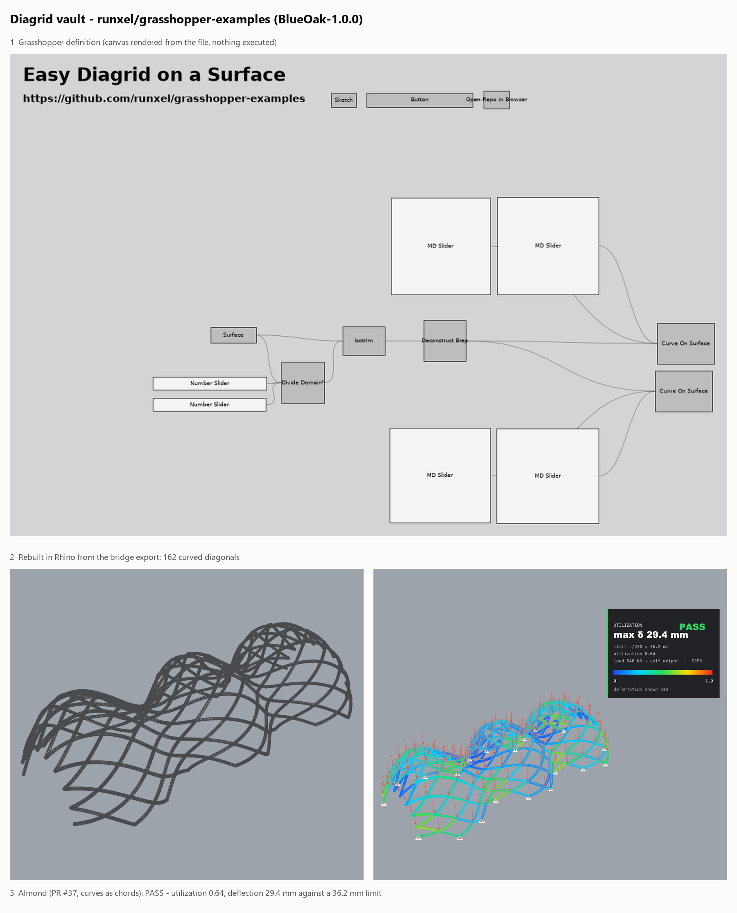
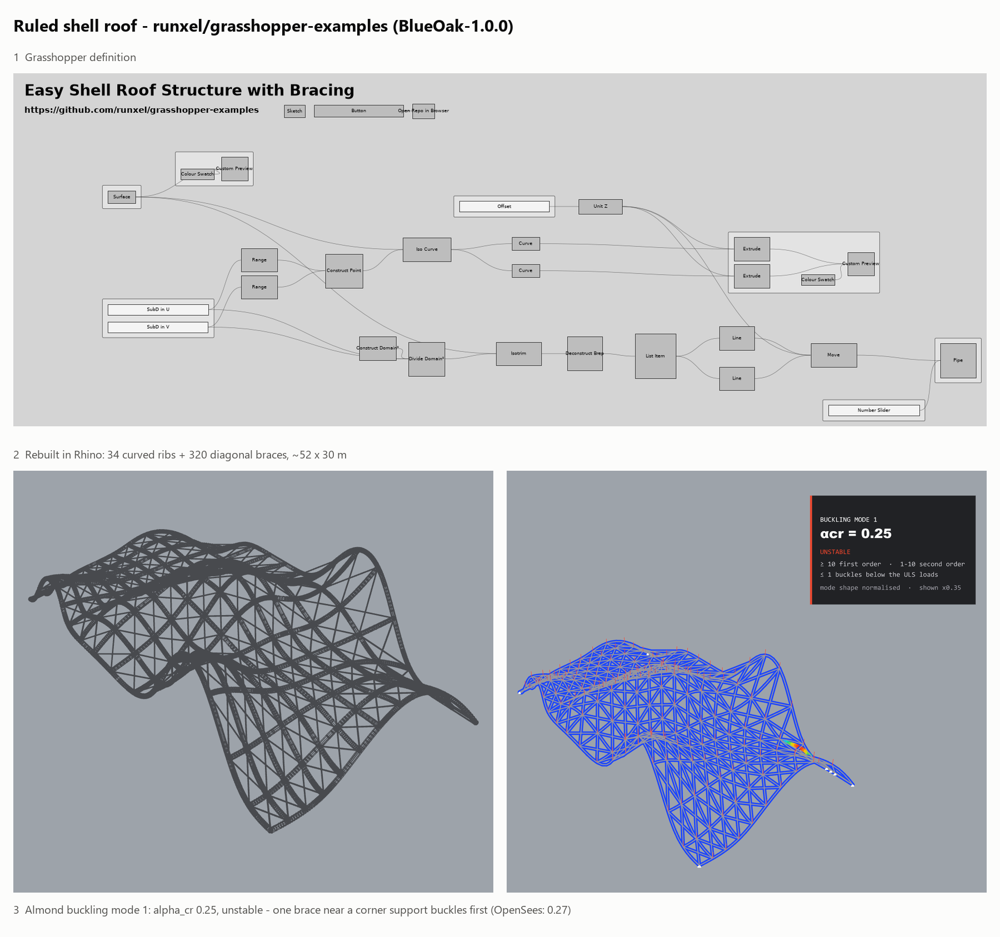
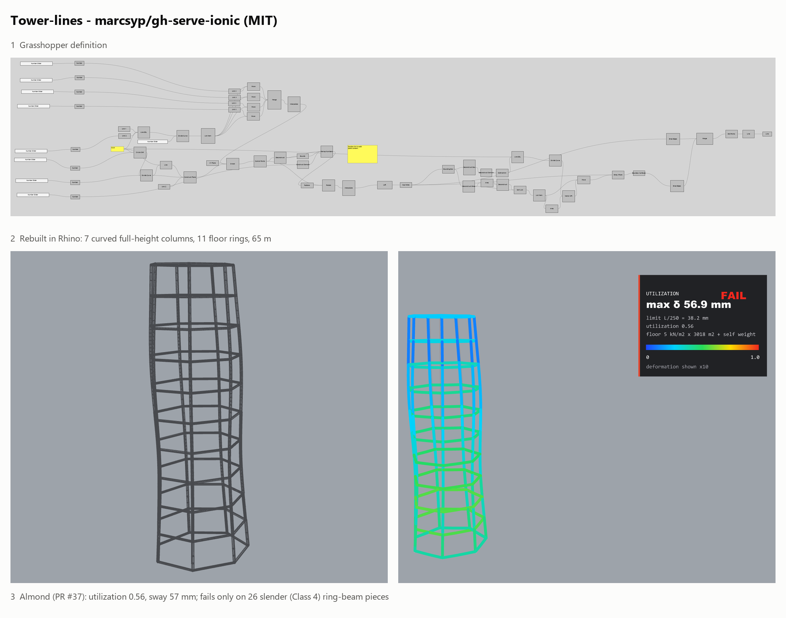
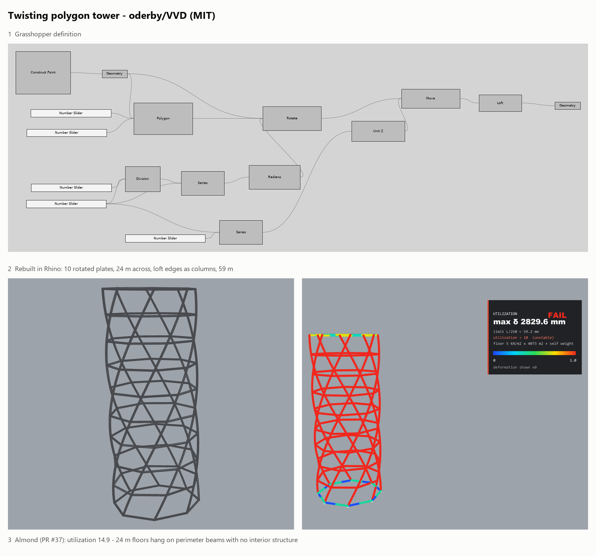
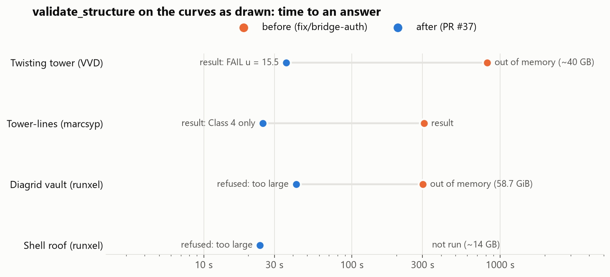
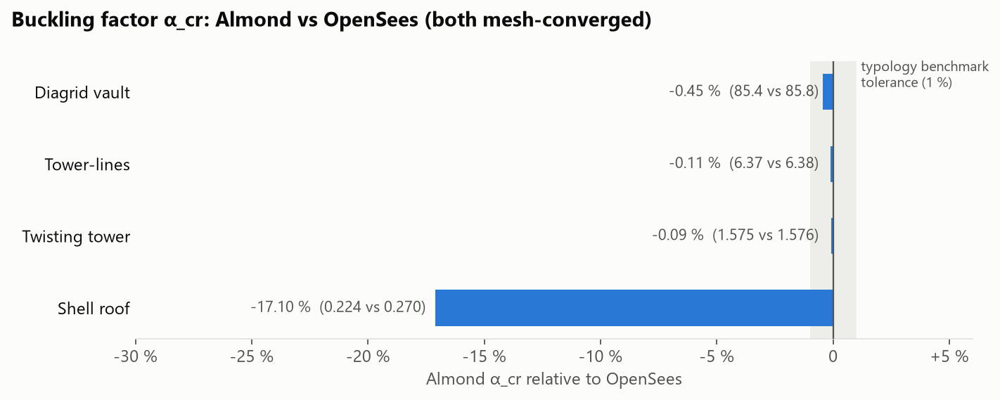

# Stress test on third-party Grasshopper definitions (2026-10-20)

Follow-up to the 2026-10-05 typology test (native frame solver vs OpenSeesPy, `benchmarks/`) and the
2026-10-11 library search (`research-2026-10-grasshopper-libraries.md`). This time the inputs are real
architectural Grasshopper files written by other people, so the whole pipeline runs:
definition → Rhino geometry → bridge `structure_model` export → `validate_structure` (native).
Companion data: `reference/gh-library-candidates-2026-10b.json` (second search pass).

## Search, second pass

78 new repos and records (none of the first 129). Searched with `.ghx` code search using structural
terms, repo search by topic and in DE/ES/FR/PT/JA, organisation listings and the Zenodo API.

| verdict | count | notes |
|---|---|---|
| accept | 25 (13 GitHub, 12 Zenodo) | MIT / Apache-2.0 / CC-BY-4.0 |
| conditional | 17 | mostly Karamba3D-dependent (closed plugin) or README-only licence |
| exclude | 36 | no licence, GPL/AGPL, NC, off-topic |

119 files downloaded (91 structural) and converted to XML at archive level. Nothing was opened in
Grasshopper or run. Stress-test candidates for the next round:

- **hasee67/Grasshopper-Scripts** (MIT, vanilla, self-contained): `Industrial Hall.ghx` (pitched portals, 36 x 30 m, 9 m bays),
  `Dome.ghx` (40 m dome on 18 columns). These are the only two vanilla frame generators in the pass.
- **Zenodo 13820807 / 13923776** (CC-BY-4.0, GhPython): Monopteros and Tholos of Vesta column rings.
- **Plugin-bound but structurally rich:** karamba3d/K3D_Resources examples (Zollamtssteg, high-rise systems,
  hybrid truss, industrial hall; Apache-2.0, need Karamba), CecilieBrandt/K2Engineering truss and gridshell
  (README-only Apache-2.0), differential-studio gridshell canopy (MIT, Kangaroo2 + 4 plugins),
  TM00/TurtleShellRoof (Apache-2.0, LunchBox + Tekla link), Alpaca4d-Lab examples (MIT, need Alpaca4d).
- **Excluded but valuable:** ITEC-GPA/BridGHe (29 bridge FEM examples) and renatogcruz trusses have no licence;
  Marco-Pellegrino/IngegneriaParametrica (79 structural files) is GPL.
- Coverage gap: about 97 repo checks hit GitHub rate limits. GitLab, Codeberg, Figshare and OSF were not searched.

Licence gaps:
- Alpaca4d-Python-Version claims Apache-2.0 in GitHub metadata but has no LICENSE file.
- arpastrana/equad's LICENSE file says only "MIT", with no copyright line.
- Two Zenodo records embed Ladybug/Honeybee (GPL/AGPL) code, with network and process calls.

## Method

Four vanilla, script-free definitions from the first corpus. Each was screened first: no script
components, and no file, network or import components. Each was solved headless in Rhino 8 through the
bridge (a GH document opened without the canvas). The chosen outputs were baked as members, with
`almond:section` user text. Supports are Almond's default, the lowest nodes, fixed.

Per case:

1. **MCP path.** `validate_structure(engine="native")` on the baked curves, exactly as a user would call it.
2. **Chord model.** The exported model with every member reduced to the straight line between its end points.
   This is what a designer would usually model, and it is small enough for the dense solver.
3. **Invariance.** The chord model was checked three ways:
   - rigid motion: rotate 37° about z, then translate (1250, −830, 42) m;
   - 0.5 mm random jitter on every member point;
   - result: change in utilization, deflection, displacement, α_cr and reactions.
4. **OpenSees cross-check.** `native_structure.build_frame` on the chord model, then `benchmarks/opensees_ref`:
   linear (ULS 6.10), α_cr, and P-Delta when α_cr < 10.

Loads used: roofs carry a point load share of 1.5 kN/m² (`load_kn`); towers carry floor loads of
2.0 dead + 3.0 imposed kN/m². Material is S355.

| case | source (licence) | members drawn → exported | structure |
|---|---|---|---|
| diagrid_vault | runxel `gh/diagrid_on_surface.ghx` (BlueOak-1.0.0) | 162 curved diagonals → 324 | diagrid on an undulating vault surface (two bays), ~10.4 m wide x 22 m, CHS 168.3x8 |
| shell_roof | runxel `gh/shell_roof.ghx` (BlueOak-1.0.0) | 34 iso-curve ribs + 320 diagonals → 764 | ruled gridshell roof 52 x 30 m, ribs box 200x500x16, braces CHS 88.9x5 |
| tower_lines | marcsyp/gh-serve-ionic `Tower-lines.ghx` (MIT) | 7 curved profile columns + 11 floor sections → 147 | 65 m tower, columns CHS 610x20, ring beams box 300x500x12 |
| version_tower | oderby/VVD `examples/versionTower.ghx` (MIT) | 10 rotated polygon plates + loft edges → 168 | 59 m twisting polygon tower, 24 m across, columns CHS 508x16 |

## Results

### Solver core: matches OpenSees

| case | nodes / elements | linear max rel. error | α_cr Almond | α_cr OpenSees | diff | P-Delta (amp. / disp. error) |
|---|---|---|---|---|---|---|
| diagrid_vault | 181 / 324 | 4.4e-13 | 85.43 (x4) | 85.82 (x8) | −0.45 % | first order |
| shell_roof | 188 / 764 | 2.4e-13 | 0.2237 (x4), 0.2249 (x2) | 0.2698 (x4), 0.2698 (x2) | **−17 %** | unstable (α_cr < 1) |
| tower_lines | 154 / 224 | 9.5e-5 \* | 6.372 (x4) | 6.382 (x8) | −0.16 % | 1.109 / 6.9e-4 |
| version_tower | 160 / 248 | 6.7e-6 \* | 1.558 (x4) | 1.560 (x8) | −0.16 % | 1.655 / 5.1e-3 (10 iterations) |

\* The towers carry trapezoidal floor loads. `opensees_ref` models these as 40 uniform strips per member,
so the error is the reference's own; models without floor loads agree to 1e-13. Equilibrium error is
below 1e-9 kN in every case.

**Open: shell_roof α_cr differs by 17 % after both solvers have converged.**
- **Values:** Almond gives 0.2249 at 2 elements per member and 0.2237 at 4. OpenSees gives 0.26980 at 2 and
  0.26982 at 4.
- **Ruled out:**
  - mesh;
  - the Wagner torsion term (switching it off leaves Almond at 0.2249);
  - auto-pinned rotation DOFs (none in this model).
- **What is known:** the model is the same `fs.Frame` for both. One element per member gives 8.24, so the
  critical mode is member buckling, most likely in the CHS 88.9x5 X-braces. The typology benchmarks never
  had slender braces inside a strongly bent, corner-supported grid (max displacement 404 mm at ULS).
- **Next:** compare the two mode shapes. Check one isolated brace against Euler with its end restraint.
  Add a third reference (MYSTRAN, or OpenSees with `Corotational` and a load-controlled path to the limit
  point). Almond is the lower (conservative) value here; until this is resolved, treat agreement to 1 % as
  shown only for the typologies.

**Invariance.** Rigid motion leaves every result unchanged (0.0), except the tower_lines
utilization, which moves 0.36 % (finding 5). The 0.5 mm jitter changes results by at most 3.6e-4,
because the jittered points weld back into the same nodes.

### Pipeline findings

1. **Curved members blow up the model, and the tool crashes instead of answering.**
   - **Cause:** the export, `RhinoAlmondBridge/StructureModelExport.cs:42`, polylines every curve to 1 mm
     deviation, and every polyline vertex becomes a frame node.
   - **diagrid_vault:** 162 gently curved diagonals become 14,799 nodes. `validate_structure` ran 301 s,
     asked for a 58.7 GiB stiffness matrix, and raised an uncaught `MemoryError`.
   - **version_tower:** 820 s, about 40 GB traced on a 31 GB machine (swapping), then `MemoryError` at 28,416 DOF.
   - **shell_roof:** would need about 7,000 nodes (estimated dense K 14 GB); the harness skipped it.
   - **tower_lines:** the curved path ran, but took 306 s against 17 s for the chord model, with the same results
     within 0.7 %.
   - **Fixes:**
     - Discretise curves for analysis to a sagitta/angle that suits the analysis, not the 1 mm document tolerance.
     - Estimate the DOF count before assembling and return a clear error ("model too large for the dense solver,
       N nodes") instead of raising.
     - The sparse solver on the roadmap removes the limit.
   - **Related:** `build_frame`'s node welding is a linear scan per point, O(n²) in Python, which adds to the time
     on large models.
2. **Deflection limit uses the longest member piece, not the structural span** (open since 2026-10-05, item 7).
   - **diagrid_vault:** span basis "member" = 1.91 m, so the limit is 7.6 mm. The real span is about 10.4 m
     (L/250 = 41.6 mm), so a vault deflecting 24.4 mm fails on deflection alone.
   - **tower_lines:** the limit comes from a 9.5 m ring-beam piece. That is plausible for the ring beams, but
     the verdict doesn't say which member it refers to.
   - **Fix:** take the span per member group (continuous line/curve lineage between supports), or the
     extent for shell-like `frame` models. Name the governing member in the verdict.
3. **Stability refinement does not scale.**
   - **shell_roof:** α_cr at 4 elements per member (3,056 elements) took 274 s; at 8 elements, `np.linalg.inv(Lc)`
     raised `MemoryError`.
   - **Cause:** dense Cholesky inverse. The validate path already splits compressed members x4, so medium
     gridshells approach this limit inside `validate_structure`.
4. **Floor loads are applied at the support level.**
   - **tower_lines:** the z = 0 ring encloses a bay, so 331 m² at ground level (1,655 kN) is "applied" and goes
     straight into the supports. Member results are unaffected, but the floor-load report and total reactions
     are inflated by about 11 %.
   - **Fix:** skip levels where every bay node is supported, or report them separately.
5. **Sway imperfections only act in ±x / ±y.**
   - **tower_lines:** rotating the 7-sided tower 37° in plan changes the utilization by 0.36 %.
   - EN 1993-1-1 5.3.2 asks for the most unfavourable direction. The global axes are not that for
     non-orthogonal plans.
   - **Fix:** add the principal directions of the first buckling mode (or the plan's principal axes) as extra
     imperfection directions.
6. **Lowest-node supports pick corner contacts.** This is correct, but worth a hint.
   - **shell_roof:** the surface touches the ground only at its corners, so 5 nodes are supported and α_cr = 0.22
     (FAIL, instability). That is right for the geometry as drawn.
   - Every rib foot sits 0.03–3 m above ground, so a designer would expect line supports. The verdict could add:
     "only N support points; X nodes lie within Y m of the ground".

Design results the definitions earned:
- **version_tower:** fails with utilization 15 and 2.7 m deflection. Its 24 m polygonal floors hang on
  perimeter beams with no interior structure.
- **tower_lines:** 29 box 300x500x12 ring-beam pieces are Class 4.

These are true failures of the drawn geometry with these sections, not pipeline faults.

## Rerun on the fix branch (PR #37, `17dd36a`)

Same four bridge exports (the fix only changes `native_structure.py`, so `validate_structure` sees identical
input), run through `native_structure.validate` exactly as the MCP tool does.

| case | before (MCP path) | after (MCP path) | after: verdict |
|---|---|---|---|
| diagrid_vault | MemoryError after 301 s | **refused in 42 s**: 2,025 nodes / 12,150 DOF, ~11.8 GB needed, 8.9 GB free | error, "too large for the dense solver" |
| shell_roof | ~14 GB (harness skipped) | **refused in 24 s**: 13,212 DOF, ~14.0 GB needed, 12.8 GB free | error, "too large for the dense solver" |
| tower_lines | 306 s, 1,876 nodes | **25 s**, 434 nodes | fail: 26 Class 4 ring-beam pieces only. Deflection passes: 5.8 mm in ring beam M12, span 9.5 m |
| version_tower | MemoryError after 820 s (~40 GB) | **36 s**, 811 MB peak | fail: utilization 15.5, deflection 2.7 m |

What holds:
- **No crashes.** Every case now ends with a result or a clear "too large" error.
- **Linear cross-check on the frames the new `build_frame` makes:** OpenSees agrees to 1.9e-11 (vault, 2,168
  elements) and 6.1e-11 (roof, 2,554 elements); the towers agree as before.
- **α_cr:** tower_lines −0.11 %, version_tower −0.09 %. P-Delta displacement error is ≤ 1e-3.
- **Raw curves vs the pre-chorded model:** within 0.4 % on tower_lines and 2.8 % on version_tower (utilization).
  Rigid motion and 0.5 mm jitter change results by ≤ 1e-3, except the known sway-direction drift
  (0.34 %, finding 5).

New issues from the rerun:
- **The two shell-like models still cannot be checked.** The 1/500 chord rule is right for these curvatures:
  a 1.9 m vault diagonal sags about 90 mm. That gives 5–6 chords per piece, and the x4 stability split
  comes on top. Pre-chorded, the same vault ran in 17 s (901 nodes after the split).
  - Options: split curved runs for stability by their chords instead of x4 per chord; or use the sparse solver.
- **The size gate depends on free RAM at call time.** The same model is analysed or refused depending on
  what else is open (8.9 GB free here; 12,150 DOF is under the 18,000 DOF limit).
  - The memory estimate (10 dense copies) may also be pessimistic: 7.0 GB was traced before the vault was
    refused.
- **Finding 2 is only half fixed for diagrids and vaults.** With `stability="off"` the vault reports 23.2 mm in
  member M77 against its own 3.45 m drawn diagonal (limit 13.8 mm), so it still fails. The 23 mm is the vault's
  global deflection (joint loads, so members barely sag between joints). It should be judged against the
  ~10.4 m vault span (41.6 mm).
- **Full-height columns drawn as one curve get the cantilever rule.**
  - version_tower: a 63.6 m loft-edge column gets span 2 x 63.6 = 127 m, so the sway limit is 509 mm, i.e. H/125.
  - That is far looser than a drift check (h/300 per storey is on the unmerged `fix/deflection-verdicts`
    branch). Merging that branch would cover it.

### Follow-up commit `4cb59b6` (PR #37)

Numbers as reported by the fix session; CI windows-release passes.

| case | after 17dd36a | after 4cb59b6 |
|---|---|---|
| diagrid_vault | refused (12,150 DOF) | **passes**, 56 s, 1,153 nodes (4 chords per piece). Utilization 0.64 (M56, buckling 6.61); global deflection 29.4 mm against 36.2 mm (span 9.05 m); local sag 0.7 mm over 1.9 m; α_cr 86.4 |
| shell_roof | refused (13,212 DOF) | analysed, 68 s, 1,083 nodes; **fails on instability, α_cr 0.25** (the OpenSees gap is unchanged) |

- **Size gate:** a fixed 6 GB dense budget; free RAM only warns. Measured peaks are 5.9 n² doubles for
  assembly and 9.7 n² for α_cr. Over budget, curves are coarsened (8 → 4 → 2 chords per piece), then the
  stability split drops to 3 or 2 elements, then the model is refused.
- **Deflection:** surface-like frames (no straight columns, not taller than wide, mostly curved or inclined
  members) get two checks:
  - global: the largest node displacement against twice the largest plan distance to the nearest support;
  - local: each member's sag between its joints against its length.
  - The verdict names which governs. Frames with columns keep the per-member check.
- **Bug found and fixed:** each chord of a curved member reported its moments in its own turned axes. That gave
  false kinks in the moment diagram and Cm = 1.0 instead of 0.4 in the 6.61 check (vault member M2: 0.42 → 1.08).
  Moments are now rotated into the member's chord axes.
- **Remaining conservatism:** `ec3.equivalent_moment_factor` sets Cm = 1.0 when a moment diagram is more than
  2 % off linear. It is why the vault reads 0.64 rather than ~0.56. A full EN 1993-1-1 Table B.3 treatment would
  remove the cliff, but it changes every member with a transverse load, so it is left for a separate change.

## Photographs of the process

Each sheet shows three steps:
1. The Grasshopper definition, drawn from the file's XML. Nothing was opened in Grasshopper or run.
2. The members as the bridge exported them, rebuilt in Rhino from the saved export.
3. Almond's `visualize_structure` overlay on PR #37 code: utilization colour, deformed shape, supports, loads.

The legend box comes from the installed almondbridge 0.7.0-rc.2. It still headlines the largest displacement,
not PR #37's governing member, and it prints a deformation scale below 1 as "x0" (twisting tower, scale 0.31).

Overlays where the curved version could not run:
- **Vault:** the overlay uses the straight-chord model, since the curved version is refused as too large.
- **Shell roof:** the overlay is first-order (`stability="off"`). Even its chord model was refused: 9,984 DOF,
  "needing about 8.0 GB (9.3 GB free)". The size gate keeps a margin below free memory as well.

## Grasshopper loading notes

- Opening a definition through `GH_DocumentIO` shows modal dialogs ("Unrecognized Objects", "IO generated N
  messages") when plugins are missing. In a headless bridge call this blocks the UI thread until the
  bridge times out (60 s), and the dialogs stay open.
- Archive-level reading (`GH_Archive.ExtractObject`) avoids the dialogs. It is untested.
- The Arup GSA examples (truss, reciprocal roof, Gerber member, 3D boxes) were not analysed.
  - Their geometry part is vanilla; the 12–22 GsaGH components can be stripped at XML level (done, not loaded).
  - Once the dialogs were dismissed, the four blocked loads finished in the background. Their documents stayed
    hooked into the viewport preview (red ✕ points in every capture) until they were disposed through the bridge.
  - A headless loader must dispose its `GH_Document`s, or they keep drawing.
- Loading further downloaded definitions in Rhino was stopped: the session's permission classifier treats
  it as running external code. Continuing needs the user's go-ahead (see below).

## Next round (pending approval)

- The shell roof now has a reproducible harness: `ParametricLibrary/capsules/structure-shell-roof-ribs.harnessed.ghx`
  with the `parametric_shell_roof_ribs_v1` capsule manifest, derived at XML level from the teaching file
  (2026-10-25, `tools/parametric_library/harness_ghx.py`). Once audited live it replaces the hand-run solve above:
  `run_gh_definition` → `ALMOND_OUT_RIB_AXES` + `ALMOND_OUT_BRACE_AXES` → `validate_structure`.
- Run the hasee67 Industrial Hall and Dome, and the stripped GSA truss / reciprocal / Gerber / boxes, through
  the same harness.
- Fix findings 1–2 first. They decide whether real GH geometry can be validated at all; 3–6 are refinements.
- Resolve the shell_roof α_cr gap before claiming OpenSees agreement for gridshells.
