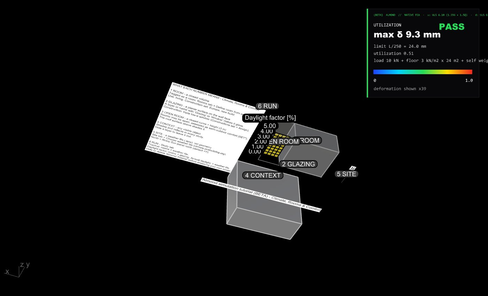
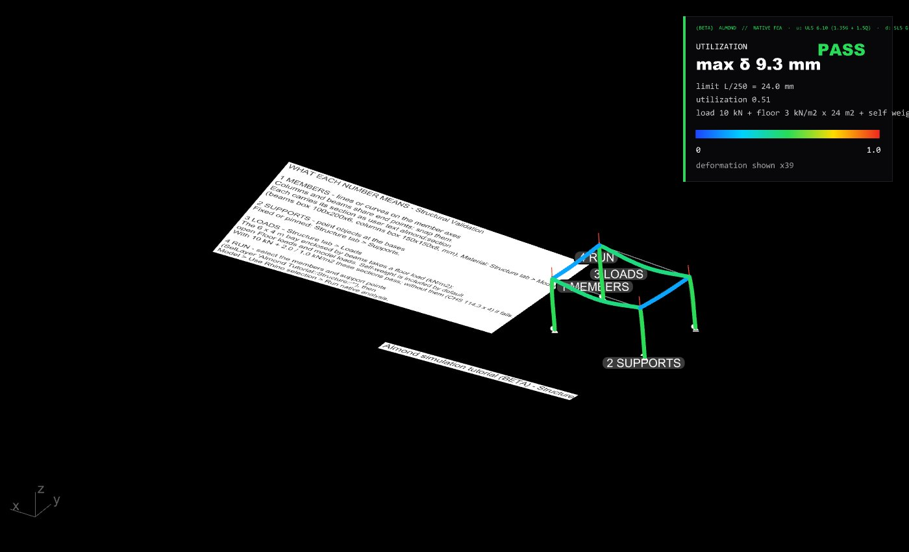
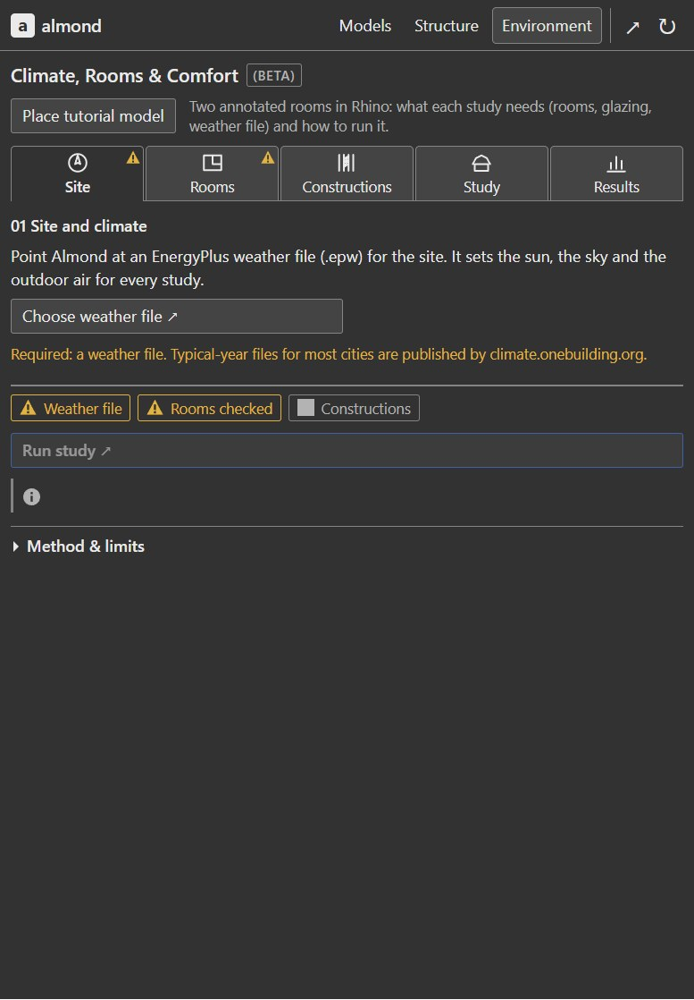
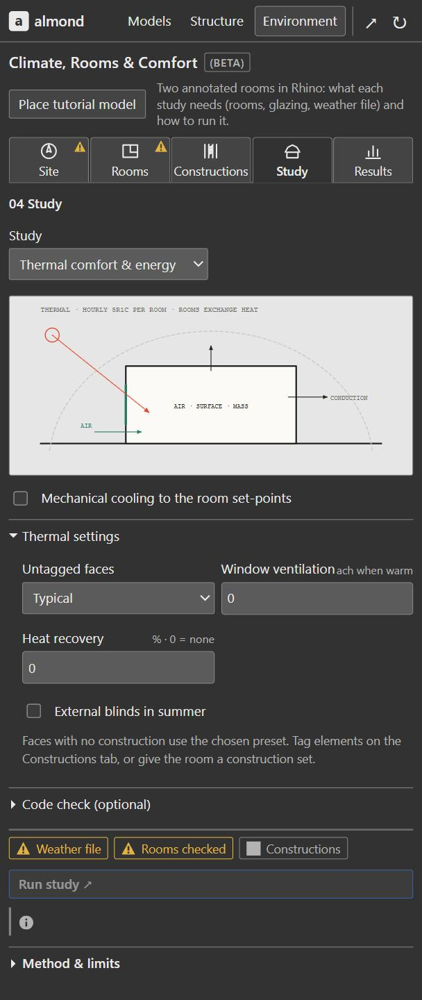
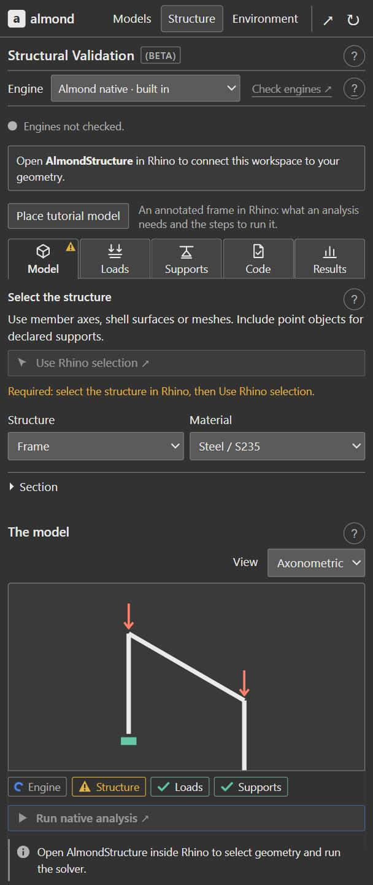
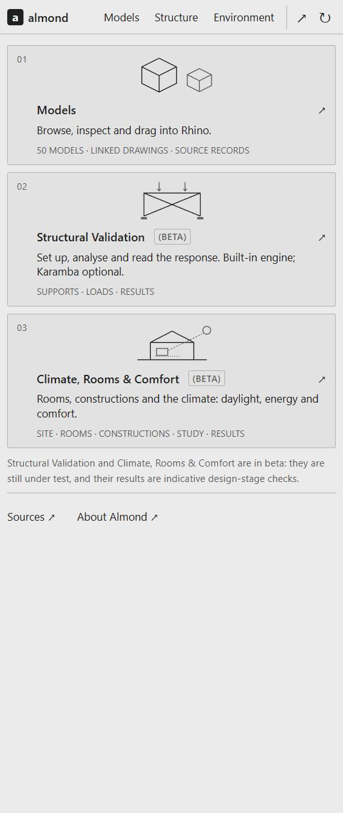
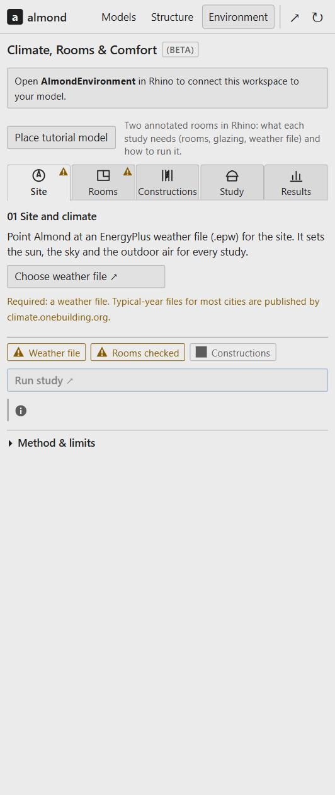

# Simulation features: stable-release readiness (BETA)

Audit of 2026-11-18, on `feat/simulation-beta-panel` (cut from master `d2de2db`). Every simulation
feature below is labelled **(BETA)**: its MCP tool descriptions, the server instructions, the README and
docs, the panel headings and home cards, the Rhino command messages (`AlmondStructure`, `AlmondKaramba`,
`AlmondEnvironment`), the **Almond Results (BETA)** panel tab and the structural viewport legend. Users
can tell the features are still under test. This page lists what has to happen before the label comes off.

**Test run:** `uv run pytest` with the .NET archive host built (`ALMOND_ARCHIVE_TEST_HOST`): **701 passed,
1 skipped** (numba not installed), plus the Node panel tests. Without the archive host 93 panel tests skip,
and that is what happens on a plain checkout, so build it before calling a release green. A headless
Rhino 8 (Rhino.Inside) run placed the tutorial model with the bridge's real `ScriptExecutor` in a mm
document (12/12 checks: sizes, tags, placement beside the user's model, replacement on re-place) and the
environment export of it gave the same rooms and daylight factor as the Python spec (3.4 % in the studio).

**Live Rhino 8 (2026-11-18):** this branch's bridge build installed into the dev package
(`0.7.1-dev.env`, previous build backed up) with the panel engine running this checkout. In the real panel
(dark theme, read through the web view's DevTools): Rhino's accent `#4889FF`, tab colour `#444444`, Segoe UI,
the beige strip hidden, "(BETA)" in both headings, all 9 advanced sections collapsed. From the panel's own
buttons: **Place tutorial model** placed both parts (17 + 18 objects); the room check found the studio
enclosed and the loggia open (52 %); a daylight-factor study gave 3.43 % in the studio (37.9 % in the
loggia); **Use Rhino selection** + **Run native analysis** on the frame with 10 kN + 2.0 / 1.0 kN/m² passed
at 9.24 mm (limit 24 mm), 50.5 %, α_cr 67.1, the same as the Python solver (9.2 mm, α_cr 67.1). Without the
tutorial's `almond:section` sizes the same frame fails (72.0 mm, 303 %, live and in Python). The viewport
legend reads "(BETA) ALMOND // NATIVE FEA …". One capture of the live panel (Site tab, below left) came
through; the others waited while the Rhino window was behind other windows, so the remaining panel images
come from the archive host.

Status key: **ready** = tested, no known blocker; **beta** = works and is tested, gaps listed; **gap** =
works but missing tests or evidence a stable label needs.

## Environment: Climate, Rooms & Comfort

| Feature (tools) | Status | Tests | Known gaps | Blocks stable |
| --- | --- | --- | --- | --- |
| Weather and climate (`climate_summary`, `sun_path`) | beta | `test_environment.py` (EPW parser repairs, NOAA sun position, degree days, wind rose) on a synthetic EPW | No real EPW in CI (licence: files are not redistributed) | A CI check against one real typical-year EPW with known values (download at test time or a permissively licensed file) |
| Daylight (`analyze_daylight`: annual sDA/ASE/UDI/EN 17037, DF, point-in-time, DGPs) | beta | `test_environment.py`: unbiased-path reference (+2–5 % bias documented), sensor grids, dynamic shades, glare clip | Curtains and interior glass no longer count as windows (#46, merged into this branch; combined with the whole-word name rules of `fix/environment-review`). No Radiance cross-check in CI | One documented comparison against a reference engine on a standard room |
| Solar radiation (`analyze_solar_radiation`) | beta | `test_environment.py` (Perez sky, bounces, sun hours) | Typical-year DNI is generous: sunshine hours read high (documented) | — |
| Thermal (`analyze_thermal`, ISO 13790 5R1C) | beta | `test_environment.py` (energy balance, TM52, adaptive, PMV) | No BESTEST/ASHRAE 140 style benchmark; air walls between zones missing | A published benchmark case (e.g. ASHRAE 140 case 600) within stated tolerance |
| Comfort calculator (`thermal_comfort`) | ready | ISO 7730 / ASHRAE 55 reference values | — | — |
| Rooms and constructions (`define_room`, `assign_construction`, `list_rooms`, `analyze_rooms`, `list_constructions`, `get_construction`) | beta | `test_rooms_constructions.py` (U-values vs hand calculation, EN ISO 13786, enclosure states, coupled rooms, panel engine), `test_simulation_beta.py` (tutorial rooms through the real engines) | Review fixes (`fix/environment-review`: name rules, TM52 season, ground floors) merged into this branch. Result plan for **cooled** rooms shows ~8760 h > 26 °C (operative temperature; read > 28 °C or the cooling load instead). External shading not credited in SC (documented, conservative). Pitched-roof R_se nit | Change or relabel the cooled-room headline metric |
| Code packs (`list_code_packs`, `check_envelope`: sg_bca, uk_adl_2021, de_banz_2020, eu_hotmaps) | beta | `test_rooms_constructions.py` (ETTV worked example, CF from EPW, pack options) | Indicative only, not certification (stated in every reply). AU NCC and NZ H1 packs deferred. `check_envelope` exported the model twice per call: **fixed here** | Keep the "indicative" wording when the BETA label comes off |
| Results drawing and runs (`show_environment_result`, `list_environment_runs`, `get_environment_run`, `list_environment_materials`) | ready | `test_environment.py` | — | — |
| Coursework tools (climate charts, shadow studies, thermal cases, EN 17037 view/sunlight, compare) and daylight-linked lighting | beta | #45 and #47 merged into this branch: `test_course_tools.py`, `test_env_panel_workflow.py`, `test_lighting_control.py`. Checked live in Rhino on the tutorial: weather file, thermal run, two kept cases compared (window ventilation 1163 h → 0 h above 26 °C), daylight factor | A panel daylight run never showed its results and kept daylight cases could not be compared (study key mismatch in #45): **fixed here** with a regression test. For a beginner the thermal table is hard to read: "1163 h > 26 °C" next to "TM52 pass" and "20 h warm" | Plain-language verdicts per room (see the beginner plan) |
| Panel workspace (`AlmondEnvironment`) | beta | `test_analysis_workspace.py` (archive host), `test_simulation_beta.py` (hierarchy keeps every scripted control, allow-list, BETA labels), `panel_theme.test.mjs` | Checked live in Rhino 8 (dark) through the panel's DOM and its buttons; light theme only in a browser with approximate colours; doc screenshots in `docs/images/tutorial/` predate the restyle | A light-theme pass in Rhino and refreshed tutorial screenshots |

## Structure: Structural Validation

| Feature (tools) | Status | Tests | Known gaps | Blocks stable |
| --- | --- | --- | --- | --- |
| Native frame solver (`frame_solver.py`, `native_structure.py`) | beta | `test_frame_solver.py`, `test_native_structure.py` (Karamba references: deflection within 1.3 %, utilization 2.4 %), `test_hand_calculations.py`, `test_structural_typologies.py` (OpenSees-verified typologies), `test_stability.py`, `test_end_releases.py`, `test_support_types.py`, `test_load_combinations.py`, `test_ec3.py` | Shell-like roofs: α_cr 17 % below OpenSees on the GH stress-test shell roof (open). Curved members become node explosions on master (fixed in open PR #37). Frames get the deflection limit of their longest member piece (#37). Only ±x/±y sway imperfections | Merge #37; resolve or document the shell-roof α_cr gap |
| EN 1993-1-1 member checks (`ec3.py`) | beta | `test_ec3.py`, `test_hand_calculations.py` | Shear, bow imperfections and lateral-torsional buckling of I-sections are on open PRs #40 and #42; concrete, timber and aluminium are indicative only | Merge #40/#42, or state the excluded checks on the result |
| `validate_structure` (engine routing, Karamba adapter, capsules, rule-based fallback) | beta | `test_validate_engines.py`, `test_capsules.py`, `test_floor_loads.py`, `test_asset_load_tools.py` | Karamba path depends on Karamba 3.1 reflection (live-tested 2026-09, no CI); rule-based fallback is low confidence by design | A recorded live Karamba smoke test per release |
| `visualize_structure` and viewport legend | beta | `test_visualize_native.py`, `test_structure_view.py` | Legend now says (BETA) | — |
| `list_design_codes`, `export_structural_report` | beta | **No test before this audit**; now `test_simulation_beta.py::test_list_design_codes_and_structural_report` | National Annex profiles are user-supplied and flagged unverified | — |
| Support types in Rhino (`almond:support` on points, per-type symbols) | not on master | Open PRs #32 (bridge) and #33 (panel) | Bridge on master treats every support point as one type | Merge #32/#33 |
| Results panel (`AlmondResults`, **Almond Results (BETA)**) | beta | `results_view.test.mjs` | Shear/LTB/bow columns are on open PR #41 | Merge #41 |
| Panel workspace (`AlmondStructure`) | beta | `test_analysis_workspace.py`, `analysis_view.test.mjs`, `test_simulation_beta.py` | Local fixes not merged: `fix/deflection-verdicts`, `fix/structural-report-verdicts`, `fix/solver-input-validation` | Merge or close those branches |

Not simulation, so not labelled: `check_egress` (rule check against curated egress rules, already says
"verify against the governing code"), `validate_scene_layout`, `evaluate_generated_asset_fit`.

## Done on this branch

- **(BETA) labels** on 23 MCP tools (18 environment, 4 structure, the new tutorial tool) and the server
  instructions; README, `environmental-analysis.md`, `structural-validation.md`, `native-solver.md`,
  `structural-tutorial.md`; panel headings, home cards and a beta note; the results page; command
  messages; the Rhino panel tab **Almond Results (BETA)**; the structural viewport legend title.
- **Hierarchy:** each tab shows its main controls; advanced options sit in collapsed sections (Section;
  Floor loads and model loads; Joints and support locations; Combinations, stability and deflection;
  More actions; Construction set and set-points; Thermal settings; Code check (optional); Daylight
  settings). A field that fails validation opens its section.
- **Rhino default style:** inside Rhino every Almond page takes Rhino's colours (panel, text, edit box,
  border, hover, inactive tab, and its accent blue from `PaintColor.PressedEnd`), its UI font at 12 px,
  flat 2 px-radius controls, Rhino-like tabs and Properties-style expanders. The beige step strip is
  hidden in the panel, brand red is gone (`--red` is Rhino's accent there), the mark is neutral, and
  warnings, errors and passes use state colours. Diagrams sit on a neutral sheet. The browser archive
  keeps its own look.
- **Tutorial model:** **Place tutorial model** in both workspaces and `place_simulation_tutorial`:
  an enclosed room with a window, an open loggia, context, north arrow and numbered dots (room, glazing,
  open room, context, site/weather file, run), and a 6 x 4 m frame with support points and dots
  (members, supports, loads, run). One spec (`almond_mcp/tutorial.py`) drives the panel button, the MCP
  tool and the tests.
- **Bug fixed:** `check_envelope` exported the whole Rhino model twice per call.
- **Found live, fixed elsewhere:** the bridge on master stamps an aligned dimension over every script's
  output (two per tutorial placement, on the Default layer). Open PR #48 (`fix/no-auto-dimensions`) removes it.

Panel pages as served by the archive host with Rhino's dark palette (read from Rhino 8) and an
approximate light one, at panel width:

The tutorial in live Rhino 8 after running both studies from the panel (daylight factor drawn in the studio,
the frame's utilization overlay with the (BETA) legend):

 

    

## Release blockers in order

1. Environment: done on this branch. `fix/environment-review`, #46, #45 and #47 are merged here, with
   their conflicts resolved beginner-first (every coursework and lighting control sits in a collapsed
   section; a test enforces it). The Atelier 07 example numbers #46 committed were computed before the
   name-rule combination: rerun them. Structure: merge #37, #40, #41, #42, #32, #33, #48 (bridge dimension
   stamp) and the local fix branches (`fix/deflection-verdicts`, `fix/structural-report-verdicts`,
   `fix/solver-input-validation`); they touch `index.html`, `karamba.js` and `results.*`, so expect
   conflicts with the hierarchy changes here.
2. Repeat the live Rhino 8 pass after the structure merges, in light and dark, with refreshed screenshots
   (the environment side was re-checked live after its merges).
3. Thermal benchmark (ASHRAE 140 style) and one real-EPW climate check in CI.
4. Fix the cooled-room headline metric; resolve or document the shell-roof α_cr gap.
5. Then remove the (BETA) labels in one change (search the repo for `(BETA)` and `beta-tag`) and bump
   the version: never reuse a Yak version.
